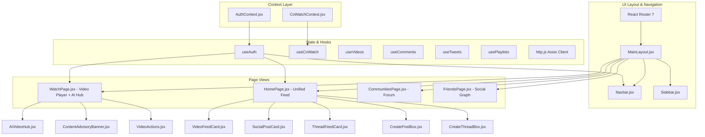

# Orbit Platform — Comprehensive Technical Implementation & Architecture Document

> **Document Purpose:** This document provides an exhaustive, self-contained technical specification of the Orbit codebase for an independent Large Language Model (LLM) or engineering team. It covers all active architectural decisions, production data models, algorithm implementations, asynchronous AI workflows, graph database mechanics, real-time protocols, API contracts, and testing frameworks based on the active production implementation.

---

## 1. System Overview & High-Level Architecture

### 1.1 Product Vision
**Orbit** is a full-stack, distributed social media and multimedia streaming platform that synthesizes the core paradigms of **YouTube** (video uploads, HLS/progressive streaming, channel subscriptions, watch history, and AI transcripts), **Twitter/X** (microblogging, short-form posts/tweets, mutual social graphs, and feed distribution), and **Reddit** (threaded community discussions, flair taxonomy, upvote/downvote algorithms, and community moderation), unified by a **real-time synchronous Co-Watching system** (WebSockets) and an **asynchronous AI intelligence engine** (audio extraction, Groq Whisper transcription, multi-task LLM content analysis, RAG copilot, and automated shadow-ban moderation).

### 1.2 Architectural Paradigm
Orbit uses a **Dual-Database Polyglot Architecture** combined with an **MVC API Service Layer** and an **Event-Driven Background Processing Engine**:
1. **Primary Persistence & Document Store:** **MongoDB (via Mongoose 8)** handles documents, entity metadata, user accounts, video metadata, comments, tweets, playlists, and aggregate pagination. (Default database namespace: `videotube`).
2. **Graph Relationship Store:** **Neo4j 5+ (via Bolt Driver)** manages high-degree social graph traversals and content connections: directional follower graphs (`:FOLLOWS`), bidirectional mutual friendships (`:FRIEND`, `:FRIEND_WITH`), community memberships (`:MEMBER_OF`), access-control blocks (`:BLOCKS`), video interactions (`:POSTED`, `:WATCHED`, `:LIKED`), and tweet/thread relationships.
3. **Real-Time Synchronous Transport:** **Socket.io 4** orchestrates real-time virtual rooms for synchronized video playback (play/pause/seek) and live chat with echo loop suppression and playback drift tolerance.
4. **Asynchronous Background Processing:** Uses Node.js non-blocking process dispatch (`setImmediate`) to offload heavy audio extraction (FFmpeg) and cloud LLM inference (Groq SDK) without stalling HTTP request/response loops.
5. **Media Storage & Global CDN:** **Cloudinary** handles cloud storage, progressive delivery, and format transcoding for avatars, cover banners, video streams, and thumbnails.
6. **Frontend Single Page Application (SPA):** Built with **React 19**, **Vite 7**, **TailwindCSS 3.4**, and **React Router 7**, featuring headless authentication routing, infinite scroll with Intersection Observers, and reactive WebSocket sync hooks.


---

## 2. Technology Stack & Runtime Specifications

| Layer | Technologies & Libraries | Version & Configuration Details |
| :--- | :--- | :--- |
| **Runtime Environment** | Node.js (ES Modules `type: "module"`), macOS/Linux | Node 20+, Native Child Process Execution (`ffmpeg`, `ffmpeg-static`) |
| **Backend Framework** | Express.js | `^5.1.0`, Custom `asyncHandler`, Standardized JSON responses, CORS with credentials |
| **Document Database** | MongoDB Atlas & Local, Mongoose ODM | `mongoose ^8.18.3`, `mongoose-aggregate-paginate-v2 ^1.1.4`, database name: `"videotube"` |
| **Graph Database** | Neo4j Community / Aura, Bolt Protocol | `neo4j-driver ^6.2.0`, `disableLosslessIntegers: true`, pool size: 50–100 connections |
| **Real-Time WebSockets**| Socket.io | Server `^4.8.4`, Client `^4.8.4`, CORS credentials with origins: `localhost`, `.vercel.app` |
| **AI Inference & LLM** | Groq Cloud SDK | `groq-sdk ^1.6.0`, Whisper Large v3, Cascading fallback: `openai/gpt-oss-120b` $\to$ `qwen/qwen3.8-27b` $\to$ `openai/gpt-oss-safeguard-20b` $\to$ `openai/gpt-oss-20b` |
| **Audio/Video Processing**| FFmpeg, Fluent-FFmpeg, FFmpeg-static | `fluent-ffmpeg ^2.1.3`, `ffmpeg-static ^5.3.0`, Libmp3lame 16kHz Mono downsampling, 24MB segment chunking |
| **Cloud Storage** | Cloudinary SDK v2, Multer Disk Storage | `cloudinary ^2.8.0`, `multer ^2.0.2`, Disk staging in `/public/temp` |
| **Authentication & Auth** | JSON Web Tokens, Bcrypt | `jsonwebtoken ^9.0.2`, `bcrypt ^6.0.0`, `cookie-parser ^1.4.7`, Access token (1d), Refresh token (10d) |
| **Frontend Framework** | React 19, Vite 7 | `react ^19.2.0`, `vite ^7.2.4`, `react-router-dom ^7.12.0`, `date-fns ^4.4.0` |
| **Styling & Icons** | Tailwind CSS, Lucide React | `tailwindcss ^3.4.17`, `lucide-react ^0.562.0` |
| **HTTP Client** | Axios | `axios ^1.6.8`, Request Interceptors, 401 Refresh Queue, automatic FormData boundary management |
| **Testing Engine** | Node.js Native Test Runner | Native `node:test` and `node:assert` across 8 dedicated subsystem test suites |

---

## 3. Directory Layout & Module Breakdown

> [!NOTE]
> **Archival Notice on `core-modules/`:** The top-level `core-modules/` directory contains standalone reference scripts and prototypes. **It is not imported or executed by the running platform.** The live production implementation is completely encapsulated within `Orbit-backend/src/` and `Orbit-frontend/src/`.

```
miniproject/
├── uml_diagrams/                 # 7 Visual System & Architecture Diagrams (PNG/JPEG)
│   ├── activity_diagram.png, class_diagram.png, component_diagram.png,
│   ├── sequence_diagram.png, use_case_better.png, usecase_diagram.jpg
│
├── setup-troubleshooting.md      # Local environment setup, Git detachment, and troubleshooting history
│
├── core-modules/                 # Standalone reference prototypes (Not used in runtime)
│   ├── authSecurity.js, communityThreads.js, cowatchSync.js, feedRanking.js,
│   ├── graphRecommendation.js, mediaUpload.js, transcriptionWorker.js,
│   ├── videoAnalysis.js, videoCopilot.js, videoModeration.js, videoRanking.js
│
├── Orbit-backend/                # Express 5 Polyglot Production Backend
│   ├── scripts/                  # Administrative maintenance & sync scripts
│   │   ├── bulkReanalyzeAll.js   # Batch migration script (BATCH_SIZE, DELAY_MS, FORCE=1)
│   │   ├── populateFriends.js    # Graph mesh populator connecting developers & movie characters
│   │   └── syncNeo4j.js          # Full MongoDB-to-Neo4j graph reconciliation engine
│   ├── seed.js                   # Seeds 10 movie characters, communities, friendships & threads
│   ├── src/
│   │   ├── app.js                # Express app setup, dynamic CORS, 16kb limit, route mounting
│   │   ├── index.js              # Server bootstrap, Socket.io attach, MongoDB + Neo4j init
│   │   ├── constants.js          # DB_NAME = "videotube"
│   │   ├── config/
│   │   │   └── neo4j.config.js   # Neo4j driver instantiation & lifecycle
│   │   ├── db/
│   │   │   └── index.js          # Mongoose connection initializer
│   │   ├── __tests__/            # 8 Native Backend Test Suites (node:test)
│   │   │   ├── community.test.js, feed.test.js, friend.test.js, graph.test.js,
│   │   │   ├── neo4j.test.js, thread.test.js, videoModeration.test.js, videoRecommendation.test.js
│   │   ├── models/               # 14 Mongoose Schema Definitions
│   │   │   ├── user.model.js, video.model.js, tweet.model.js, comment.model.js,
│   │   │   ├── like.model.js, playlist.model.js, subscription.model.js,
│   │   │   ├── community.model.js, communityMembership.model.js, thread.model.js,
│   │   │   ├── threadVote.model.js, friendRequest.model.js, notification.model.js, report.model.js
│   │   ├── controllers/          # 17 MVC Business Logic Handlers
│   │   │   ├── ai.controller.js, comment.controller.js, community.controller.js,
│   │   │   ├── dashboard.controller.js, explore.controller.js, feed.controller.js,
│   │   │   ├── friend.controller.js, graph.controller.js, like.controller.js,
│   │   │   ├── notification.controller.js, playlist.controller.js, recommendation.controller.js,
│   │   │   ├── subscription.controller.js, thread.controller.js, tweet.controller.js,
│   │   │   ├── user.controller.js, video.controller.js
│   │   ├── routes/               # Express Router declarations matching controllers
│   │   ├── middlewares/
│   │   │   ├── auth.middleware.js   # verifyJWT & optionalAuth middlewares
│   │   │   └── multer.middleware.js # Multi-part form staging to public/temp
│   │   ├── services/
│   │   │   ├── ai/               # Groq LLM multi-task analysis & RAG chatbot
│   │   │   ├── graph/            # Cypher queries, BFS shortest path, DFS, unified feed generator
│   │   │   ├── moderation/       # Content safety classification, toxicity evaluation, shadow banning
│   │   │   ├── recommendation/   # TF-IDF NLP vectorizer, Cosine Similarity, Jaccard friend scoring
│   │   │   ├── transcription/    # 24MB audio chunker, FFmpeg extractor, Groq Whisper pipeline
│   │   │   └── ranking.service.js# MongoDB Aggregation Hot sorting pipelines
│   │   ├── socket/
│   │   │   └── cowatch.socket.js # Real-time Co-Watch room manager & sync engine
│   │   └── utils/
│   │       ├── ApiError.js, ApiResponse.js, asyncHandler.js, cloudinary.js
│
├── Orbit-frontend/               # React 19 Client SPA
│   ├── vercel.json               # SPA routing rewrite & security headers
│   ├── src/
│   │   ├── App.jsx               # Client route tree (21 routes, ProtectedRoute, AuthRoute)
│   │   ├── main.jsx              # DOM root render & Context provider injection
│   │   ├── api/                  # 16 Modular Axios endpoint wrappers
│   │   │   ├── http.js           # Axios instance with 401 retry queue & FormData boundary cleanup
│   │   │   └── *.api.js          # Specialized API wrappers
│   │   ├── context/
│   │   │   ├── AuthContext.jsx   # Current user state, login, register, token sync
│   │   │   └── CoWatchContext.jsx# WebSocket sync, drift tolerance, echo loop suppression
│   │   ├── hooks/                # 6 Custom React hooks (useAuth, useCoWatch, useVideos, useComments, etc.)
│   │   ├── layouts/
│   │   │   └── MainLayout.jsx    # Persistent Navbar, Collapsible Sidebar, Viewport shell
│   │   ├── pages/                # 21 Application Screen Views
│   │   └── components/           # UI Component hierarchy
│   │       ├── video/            # AiVideoHub, ContentAdvisoryBanner, VideoCard, VideoActions
│   │       ├── cowatch/          # CoWatchPanel, CoWatchVideosBanner, CoWatchNavButton
│   │       ├── feed/             # VideoFeedCard, SocialPostCard, ThreadFeedCard, CreatePostBox, CreateThreadBox
│   │       ├── community/        # CommunityMembersModal, CreateCommunityModal
│   │       └── layout/           # Navbar, Sidebar, ProtectedRoute
│
└── scripts/
    └── stressTestGraph.js        # Concurrency benchmark for Neo4j mutual friend & recommendation queries
```

---

## 4. Database Architecture & Data Models

### 4.1 MongoDB / Mongoose Collections

#### 1. User (`users`)
* Primary identity and credential store.
* **Fields:**
  * `username` (String, required, unique, lowercase, trimmed, indexed)
  * `email` (String, required, unique, lowercase, trimmed)
  * `fullName` (String, required, trimmed, indexed)
  * `avatar` (String, Cloudinary CDN URL, required)
  * `coverImage` (String, Cloudinary CDN URL, optional)
  * `password` (String, bcrypt hash with 10 salt rounds)
  * `refreshToken` (String, active refresh JWT)
  * `watchHistory` (Array of `ObjectId` referencing `Video`)
  * `timestamps` (`createdAt`, `updatedAt`)
* **Hooks & Methods:**
  * `pre("save")`: Hashes `password` using `bcrypt.hash(..., 10)` if modified.
  * `isPasswordCorrect(plainPassword)`: Returns `bcrypt.compare`.
  * `generateAccessToken()`: Signs payload `({ _id, email, username, fullName })` with `ACCESS_TOKEN_SECRET` (expiry: `1d`).
  * `generateRefreshToken()`: Signs payload `({ _id })` with `REFRESH_TOKEN_SECRET` (expiry: `10d`).

#### 2. Video (`videos`)
* Rich multimedia record storing video assets, playback metrics, and AI metadata.
* **Fields:**
  * `videoFile` (String, Cloudinary video URL, required)
  * `thumbnail` (String, Cloudinary image URL, required)
  * `title` (String, required)
  * `description` (String, required)
  * `duration` (Number, length in seconds, required)
  * `views` (Number, total view count, default: 0)
  * `viewedBy` (Array of `ObjectId` referencing `User` for unique viewer tracking)
  * `isPublished` (Boolean, default: true)
  * `owner` (`ObjectId` referencing `User`, indexed, required)
  * `transcript` (String, raw full-text transcription from Whisper, default: null)
  * `caption_vtt` (String, fully formatted WebVTT subtitle track, default: null)
  * `transcription_status` (Enum: `["pending", "processing", "completed", "failed"]`, default: `"pending"`, indexed)
  * `transcription_error` (String, default: null)
  * `segments` (Array of `{ start: Number, end: Number, text: String }`)
  * `aiAnalysis`:
    * `tldr` (String, default: null)
    * `keyPoints` (Array of Strings, default: [])
    * `chapters` (Array: `[{ timestamp: Number, formattedTime: String, title: String }]`)
    * `analysisStatus` (Enum: `["pending", "processing", "completed", "failed"]`, default: `"pending"`)
  * `aiAdvisory`:
    * `hasAdvisory` (Boolean, default: false)
    * `category` (Enum: `["medical", "financial", "legal", "none"]`, default: `"none"`)
    * `riskLevel` (Enum: `["high", "medium", "low", "none"]`, default: `"none"`)
    * `disclaimerTitle` (String, default: null)
    * `disclaimerMessage` (String, default: null)
  * `isShadowBanned` (Boolean, default: false, indexed — excluded from public feeds when true)
  * `toxicityScore` (Number, 0.00 to 1.00, default: 0)
  * `isVulgar` (Boolean, default: false)
  * `flaggedCategories` (Array of Strings, default: [])
  * `moderationStatus` (Enum: `["pending", "processing", "completed", "failed"]`, default: `"pending"`, indexed)
  * `moderationError` (String, default: null)
  * `moderatedAt` (Date, default: null)
* **Plugins:** `mongoose-aggregate-paginate-v2` for cursor/page pagination.

#### 3. Community (`communities`)
* Reddit-style subreddit equivalent.
* **Fields:**
  * `name` (String, required, trimmed)
  * `slug` (String, unique, lowercase, trimmed, indexed, required)
  * `description` (String, trimmed, default: "")
  * `rules` (Array of Strings, default: [])
  * `avatar` (String, Cloudinary URL, default: "")
  * `banner` (String, Cloudinary URL, default: "")
  * `creator` (`ObjectId` referencing `User`, required)
  * `privacy` (Enum: `["PUBLIC", "PRIVATE"]`, default: `"PUBLIC"`, required)
  * `memberCount` (Number, default: 1)
* **Plugins:** `mongoose-aggregate-paginate-v2`.

#### 4. CommunityMembership (`communitymemberships`)
* Joins users to communities with role-based access control.
* **Fields:**
  * `userId` (`ObjectId` referencing `User`, indexed, required)
  * `communityId` (`ObjectId` referencing `Community`, indexed, required)
  * `role` (Enum: `["OWNER", "MODERATOR", "MEMBER"]`, default: `"MEMBER"`)
  * `status` (Enum: `["PENDING", "APPROVED", "BANNED"]`, default: `"APPROVED"`)
* **Compound Index:** `{ userId: 1, communityId: 1 }` (unique constraint).

#### 5. Thread (`threads`)
* Forum discussions posted inside communities.
* **Fields:**
  * `communityId` (`ObjectId` referencing `Community`, indexed, required)
  * `authorId` (`ObjectId` referencing `User`, indexed, required)
  * `title` (String, required, trimmed, maxlength: 300)
  * `body` (String, trim: true)
  * `media` (String, optional image or video URL)
  * `flair` (String, trim: true)
  * `score` (Number, default: 0, indexed)
  * `commentCount` (Number, default: 0)
  * `isModeratorRemoved` (Boolean, default: false)
* **Compound Indexes:** `{ communityId: 1, createdAt: -1 }`, `{ communityId: 1, score: -1 }`.
* **Plugins:** `mongoose-aggregate-paginate-v2`.

#### 6. ThreadVote (`threadvotes`)
* Tracks individual user up/down votes on threads.
* **Fields:**
  * `threadId` (`ObjectId` referencing `Thread`, indexed, required)
  * `userId` (`ObjectId` referencing `User`, indexed, required)
  * `value` (Number, `1` for upvote, `-1` for downvote, required)
* **Compound Index:** `{ threadId: 1, userId: 1 }` (unique constraint).

#### 7. Tweet / Social Post (`tweets`)
* Microblogging post (Twitter style).
* **Fields:**
  * `owner` (`ObjectId` referencing `User`, required, indexed)
  * `content` (String, required)
  * `image` (String, optional Cloudinary media attachment URL)

#### 8. Comment (`comments`)
* Multi-purpose commenting model supporting video comments, thread comments, and tweet replies.
* **Fields:**
  * `content` (String, required)
  * `owner` (`ObjectId` referencing `User`, required)
  * `video` (`ObjectId` referencing `Video`, optional)
  * `thread` (`ObjectId` referencing `Thread`, optional)
  * `tweet` (`ObjectId` referencing `Tweet`, optional)
  * `parentComment` (`ObjectId` referencing `Comment`, nullable for nested replies)
  * `isModeratorRemoved` (Boolean, default: false)
* **Plugins:** `mongoose-aggregate-paginate-v2`.

#### 9. Like (`likes`)
* Polymorphic like model with partial unique indexes to guarantee single-like integrity without null collisions.
* **Fields:**
  * `likedBy` (`ObjectId` referencing `User`, required)
  * `video` (`ObjectId` referencing `Video`, optional)
  * `comment` (`ObjectId` referencing `Comment`, optional)
  * `tweet` (`ObjectId` referencing `Tweet`, optional)
* **Partial Unique Indexes:**
  * `{ video: 1, likedBy: 1 }` (unique: true, partialFilterExpression: `{ video: { $exists: true } }`)
  * `{ comment: 1, likedBy: 1 }` (unique: true, partialFilterExpression: `{ comment: { $exists: true } }`)
  * `{ tweet: 1, likedBy: 1 }` (unique: true, partialFilterExpression: `{ tweet: { $exists: true } }`)

#### 10. Subscription (`subscriptions`)
* YouTube-style channel follow model.
* **Fields:**
  * `subscriber` (`ObjectId` referencing `User`, the follower)
  * `channel` (`ObjectId` referencing `User`, creator being followed)

#### 11. FriendRequest (`friendrequests`)
* Two-phase social relationship management.
* **Fields:**
  * `sender` (`ObjectId` referencing `User`, required)
  * `receiver` (`ObjectId` referencing `User`, required)
  * `status` (Enum: `["PENDING", "ACCEPTED", "REJECTED"]`, default: `"PENDING"`)
* **Compound Index:** `{ sender: 1, receiver: 1 }` (unique constraint).

#### 12. Playlist (`playlists`)
* Custom video collections.
* **Fields:**
  * `name` (String, required)
  * `description` (String)
  * `videos` (Array of `ObjectId` referencing `Video`)
  * `owner` (`ObjectId` referencing `User`)

#### 13. Notification (`notifications`)
* Alerts for social actions and engagements.
* **Fields:**
  * `recipient` (`ObjectId` referencing `User`, indexed, required)
  * `sender` (`ObjectId` referencing `User`, required)
  * `type` (Enum: `["FRIEND_REQUEST", "FRIEND_ACCEPT", "LIKE", "COMMENT", "SUBSCRIBE", "COMMUNITY_JOIN", "NEW_POST"]`, required)
  * `entityId` (`ObjectId`, optional)
  * `entityModel` (String, optional)
  * `message` (String, required)
  * `isRead` (Boolean, default: false)

#### 14. Report (`reports`)
* User reporting pipeline for community moderation.
* **Fields:**
  * `reporter` (`ObjectId` referencing `User`, required)
  * `reason` (String, required)
  * `targetType` (Enum: `["THREAD", "COMMENT"]`, required)
  * `targetId` (`ObjectId`, required, refPath: `'targetTypeModel'`)
  * `targetTypeModel` (Enum: `["Thread", "Comment"]`, required)
  * `communityId` (`ObjectId` referencing `Community`, optional)
  * `status` (Enum: `["PENDING", "RESOLVED", "DISMISSED"]`, default: `"PENDING"`)

---

### 4.2 Neo4j Graph Model & Cypher Schema

Neo4j models the high-dimensional social topology to avoid recursive joins in MongoDB. The full graph reconciliation script (`scripts/syncNeo4j.js`) synchronizes users, communities, videos, tweets, and interactions.

#### Node Labels:
1. `(:User { mongoId, id, username, name, email, avatar })`
2. `(:Community { mongoId, id, name, slug, description })`
3. `(:Video { mongoId, id, title, description, views, duration, isPublished })`
4. `(:Tweet { mongoId, id, content })`
5. `(:Thread { mongoId, id, title, body, score })`

#### Relationships:
1. `(u1:User)-[:FRIEND]->(u2:User)`: Reciprocal friendship (created symmetrically in both directions upon accepting a request).
2. `(u1:User)-[:FRIEND_WITH]->(u2:User)`: Undirected semantic friendship alias.
3. `(u1:User)-[:FOLLOWS]->(u2:User)`: Unidirectional subscription / follow.
4. `(u:User)-[:MEMBER_OF { role, status }]->(c:Community)`: User joined community.
5. `(u1:User)-[:BLOCKS]->(u2:User)`: Explicit user block.
6. `(u:User)-[:POSTED]->(v:Video)` / `(u:User)-[:POSTED]->(t:Tweet)` / `(u:User)-[:POSTED]->(th:Thread)`: Authorship.
7. `(u:User)-[:WATCHED]->(v:Video)`: Video view tracking.
8. `(th:Thread)-[:POSTED_IN]->(c:Community)`: Community containment.
9. `(u:User)-[:LIKED]->(v:Video)` / `(u:User)-[:LIKED]->(t:Tweet)`: Content likes.
10. `(u:User)-[:COMMENTED_ON { content }]->(v:Video)` / `(u:User)-[:COMMENTED_ON { content }]->(t:Tweet)`: Comments.
11. `(u:User)-[:VOTED { value: 1 | -1 }]->(th:Thread)`: Thread up/down votes.

#### Constraints:
```cypher
CREATE CONSTRAINT user_mongoId IF NOT EXISTS FOR (u:User) REQUIRE u.mongoId IS UNIQUE;
CREATE CONSTRAINT comm_mongoId IF NOT EXISTS FOR (c:Community) REQUIRE c.mongoId IS UNIQUE;
CREATE CONSTRAINT video_mongoId IF NOT EXISTS FOR (v:Video) REQUIRE v.mongoId IS UNIQUE;
CREATE CONSTRAINT tweet_mongoId IF NOT EXISTS FOR (t:Tweet) REQUIRE t.mongoId IS UNIQUE;
CREATE CONSTRAINT thread_mongoId IF NOT EXISTS FOR (th:Thread) REQUIRE th.mongoId IS UNIQUE;
```

---

## 5. Core Algorithms & Mathematical Formulations

### 5.1 Community Thread "Hot" Ranking (`ranking.service.js`)
Implements native Reddit/HackerNews gravity scoring directly inside **MongoDB Aggregation Pipelines** (`getThreadSortPipeline`):

$$\text{ageInHours} = \frac{\text{new Date}() - \text{createdAt}}{1000 \times 60 \times 60}$$

$$\text{hotness} = \frac{\max(\text{score}, 0)}{(\text{ageInHours} + 2)^{1.8}}$$

* **Pipeline Stages Injected:**
  ```javascript
  {
    $addFields: {
      hotness: {
        $divide: [
          { $max: ["$score", 0] },
          { $pow: [{ $add: [{ $divide: [{ $subtract: [new Date(), "$createdAt"] }, 3600000] }, 2] }, 1.8] }
        ]
      }
    }
  },
  { $sort: { hotness: -1 } }
  ```
* For `"top"` sort, it sorts by `{ score: -1, createdAt: -1 }`; for `"new"`, `{ createdAt: -1 }`.

---

### 5.2 Heterogeneous Master Feed Ranking (`feedCandidate.service.js` & `feedRanking.service.js`)
Used to assemble, filter, and score heterogeneous items (Videos, Posts, Threads) for the authenticated home feed:

1. **Candidate Retrieval Streams (up to 50 items each):**
   - **Community Threads:** Threads from communities the user has joined (`status: "APPROVED"`).
   - **Creator Videos:** Videos published by channels the user subscribes to (`Subscription.find()`).
   - **Friend Posts (Tweets):** Tweets published by users connected via Neo4j `:FRIEND` edges.
   - **Popular Fallback:** Platform-wide top videos, top threads, and recent posts.
2. **Access Control & Safety Filtering:**
   - **Block List:** Filters out items authored by users connected via Neo4j `(:User)-[:BLOCKS]->(:User)`.
   - **Deduplication:** Filters out redundant occurrences using a `Set<contentId>`.
   - **Private Community Visibility:** Threads posted in a `PRIVATE` community are strictly excluded unless the user is an approved member (`c.reason.includes("community you joined")`).
   - **Shadow Ban Exclusions:** All candidate video queries enforce `{ isShadowBanned: { $ne: true } }`.
3. **Gravity Scoring Formula (`rankCandidates`):**
   - Age calculation: $\text{ageHours} = \max\left(0.1, \frac{\text{now} - \text{createdAt}}{3600000}\right)$.
   - Log-dampening video views:
     $$\text{scoreWeight}(\text{video}) = \log_{10}(\max(1, \text{views})) \times 10$$
   - Tweet flat score bump: $\text{scoreWeight}(\text{post}) = 5$.
   - Affinity reason multipliers:
     $$\text{multiplier} = \begin{cases} 2.0 & \text{if posted by a friend} \\ 1.5 & \text{if from a followed creator} \\ 1.3 & \text{if from a joined community} \\ 1.0 & \text{otherwise (popular fallback)} \end{cases}$$
   - Final item score:
     $$\text{finalScore} = \frac{(\max(\text{scoreWeight}, 0) + 1) \times \text{multiplier}}{(\text{ageHours} + 2)^{1.5}}$$
4. **Stateless Cursor Pagination:**
   The feed encodes the boundary item's floating-point `finalScore` into a base64 string cursor. Page 2 requests supply this cursor to resume slicing candidates whose `finalScore <= cursorScore`.
5. **Post-Enrichment:**
   Enriches the paginated slice with user-specific state: checks if the authenticated user liked the post (`Like.exists`) or voted on the thread (`ThreadVote.findOne`).

---

### 5.3 Hybrid Content & Social Video Recommendation (`videoRecommendation.service.js` & `nlp.service.js`)
Combines Natural Language Processing (NLP) content similarity with social graph activity.

1. **Text Preprocessing & TF-IDF Vectorization (`nlp.service.js`):**
   * Tokenization, lowercasing, punctuation stripping, stopword removal.
   * Term Frequency: $\text{TF}(t, d) = \frac{\text{count}(t, d)}{|d|}$.
   * Inverse Document Frequency: $\text{IDF}(t, D) = \log\left(\frac{1 + |D|}{1 + \text{DF}(t, D)}\right) + 1$.
   * TF-IDF Vector: $\vec{V}_d(t) = \text{TF}(t, d) \times \text{IDF}(t, D)$.
2. **Content Similarity ($S_c$):**
   Cosine similarity between target video vector $\vec{A}$ and candidate vector $\vec{B}$:
   $$S_c = \frac{\vec{A} \cdot \vec{B}}{\|\vec{A}\| \|\vec{B}\|} = \frac{\sum A_i B_i}{\sqrt{\sum A_i^2} \sqrt{\sum B_i^2}}$$
3. **Graph Score ($S_g$):**
   Calculated by querying Neo4j for network interactions on the candidate video by mutual friends.
4. **Min-Max Normalization:**
   $$\text{norm}(S) = \frac{S - S_{\min}}{S_{\max} - S_{\min}} \quad (\text{bounded to } [0, 1])$$
5. **Hybrid Score Fusion:**
   $$R = (w_G \times \text{norm}(S_g)) + (w_C \times \text{norm}(S_c)) \quad (w_G = 0.60, w_C = 0.40)$$
6. **Popularity Fallback:** If the engine returns zero recommendations, falls back to:
   ```javascript
   Video.find({ isPublished: true, isShadowBanned: { $ne: true }, _id: { $ne: videoId } })
     .sort({ views: -1, createdAt: -1 })
     .limit(limit)
   ```

---

### 5.4 Graph Social Distance & Multi-Tier User Recommendations (`userRecommendation.service.js`)

1. **2-Hop Friend-of-Friend (FoF) & Community Overlap:**
   ```cypher
   MATCH (u:User {mongoId: $userId})
   MATCH (u)-[:FRIEND|FRIEND_WITH|MEMBER_OF*2]-(candidate:User)
   WHERE u <> candidate
     AND NOT (u)-[:FRIEND|FRIEND_WITH]-(candidate)
     AND NOT (u)-[:BLOCKS]-(candidate)
   WITH DISTINCT u, candidate
   OPTIONAL MATCH (u)-[:FRIEND|FRIEND_WITH]-(mf:User)-[:FRIEND|FRIEND_WITH]-(candidate)
   WITH u, candidate, count(DISTINCT mf) AS mutualFriendsCount
   OPTIONAL MATCH (u)-[:MEMBER_OF]->(mc:Community)<-[:MEMBER_OF]-(candidate)
   WITH candidate, mutualFriendsCount, count(DISTINCT mc) AS mutualCommsCount,
        (mutualFriendsCount * 2.0 + mutualCommsCount * 1.0) AS score
   WHERE score > 0
   ORDER BY score DESC
   LIMIT toInteger($limit)
   RETURN candidate.mongoId AS candidateId, score, mutualFriendsCount, mutualCommsCount
   ```
2. **Multi-Tier Fallbacks:**
   * **Tier 1 (Fill Slots):** If 2-hop results are fewer than requested `limit`, executes a Neo4j Cypher query filling remaining slots with active users labeled `'People on Orbit'`.
   * **Tier 2 (MongoDB Mutual Friends):** If Neo4j is offline, falls back to querying `FriendRequest.find({ status: "ACCEPTED" })` in MongoDB.
   * **Tier 3 (Random Platform Users):** If mutual friends are still empty, samples random users from MongoDB: `User.find({ _id: { $nin: excludeIds } })`.

3. **Shortest Path BFS (`bfs.service.js`):**
   ```cypher
   MATCH (start:User {mongoId: $startUserId}), (end:User {mongoId: $targetUserId})
   MATCH p = shortestPath((start)-[:FRIEND*1..6]-(end))
   RETURN [x IN nodes(p) | x.mongoId] AS path
   ```

4. **Depth-First Search (DFS) Traversal (`dfs.service.js`):**
   ```cypher
   MATCH p = (start:User {mongoId: $startUserId})-[:FRIEND*1..6]-(end:User)
   RETURN [x IN nodes(p) | x.mongoId] AS path LIMIT 100
   ```

---

### 5.5 Thread Comments Tree (`thread.controller.js:getThreadComments`)
Instead of in-memory tree reconstruction, comments are queried directly via **MongoDB Aggregation Pipelines**:
* Queries `{ thread: id, isModeratorRemoved: false, parentComment: parentId || null }`.
* Sorted by `{ createdAt: 1 }` (oldest first).
* The frontend recursively renders nested replies via `CommentRow` on demand.

---

## 6. Asynchronous Media & AI Intelligence Pipelines

```mermaid
sequenceDiagram
    autonumber
    actor User as Client
    participant Express as Video Controller
    participant Cloudinary as Cloudinary CDN
    participant Disk as Local Temp Disk
    participant Worker as Transcription Worker
    participant FFmpeg as FFmpeg Static
    participant GroqWhisper as Groq Whisper Large v3
    participant Mongo as MongoDB
    participant GroqLLM as Groq LLM Cascade

    User->>Express: POST /api/v1/videos (Multer multipart form)
    Express->>Disk: Buffer video & thumbnail to /public/temp
    Express->>Cloudinary: Upload videoFile (deleteAfterUpload: false)
    Express->>Cloudinary: Upload thumbnail (deleteAfterUpload: true)
    Express->>Mongo: Create Video (transcription_status: "pending")
    Express-->>User: 201 Created (Video document returned immediately)

    Note over Express,Worker: Non-blocking setImmediate()
    Express->)Worker: processVideoTranscription(videoId, videoLocalPath)

    Worker->>Mongo: Update status to "processing"
    Worker->>FFmpeg: Downsample audio (16kHz mono MP3)
    FFmpeg->>Disk: Output temp .mp3 audio file

    alt Audio Size > 24 MB
        Worker->>FFmpeg: Split into 15-minute chunks (-f segment -segment_time 900)
        Worker->>GroqWhisper: Transcribe chunks sequentially with timestamp offsets
    else Audio Size <= 24 MB
        Worker->>GroqWhisper: Stream single MP3 to whisper-large-v3
    end

    GroqWhisper-->>Worker: Verbose JSON (Text + Timestamped Segments)
    Worker->>Worker: Generate WebVTT string & subtitle track
    Worker->>Mongo: Update Video (transcript, caption_vtt, segments, status: "completed")
    Worker->>Disk: Unlink temporary video & audio files

    par Concurrent Post-Processing
        Worker->)GroqLLM: analyzeVideoById() -> TL;DR, Key Takeaways, Chapters, Advisory
        GroqLLM-->>Mongo: Update Video (aiAnalysis, aiAdvisory)
    and
        Worker->)GroqLLM: moderateVideoById() -> Toxicity Score, Category Flags, Shadow Ban
        GroqLLM-->>Mongo: Update Video (isShadowBanned, toxicityScore, flaggedCategories)
    end
```

### 6.1 Audio Downsampling & 24MB Large File Chunking (`groqTranscription.service.js`)
* Downsamples to 16 kHz mono MP3:
  ```bash
  ffmpeg -y -i "{sourceMedia}" -vn -acodec libmp3lame -ar 16000 -ac 1 "{tempAudioPath}"
  ```
* **24MB Safe Chunking:** Groq has a strict 25MB file upload limit. If the extracted audio exceeds 24MB (`MAX_SAFE_FILE_SIZE = 24 * 1024 * 1024`), the worker automatically executes:
  ```bash
  ffmpeg -i "{inputAudioPath}" -f segment -segment_time 900 -c copy "{outputDir}/chunk_%03d.mp3"
  ```
  It splits the media into 15-minute chunks without re-encoding, transcribes them sequentially, offsets timestamps by `chunkIndex * 900`, and stitches them into a unified WebVTT track.

### 6.2 Multi-Task Content Intelligence Prompt (`videoAnalysis.service.js`)
* **Prompt Optimization:** Long transcripts are window-bucketed across time (~50 anchor points) to strictly stay below Groq's 12,000 character rate limit.
* **Model Cascade:** Uses `process.env.ANALYSIS_MODEL || "openai/gpt-oss-120b"`, falling back to `"qwen/qwen3.8-27b"`, then `"openai/gpt-oss-20b"`.
* **Output Format:** Strict JSON output validated against:
  * `tldr`: 2-sentence executive summary.
  * `keyPoints`: Array of 3–5 bullet points.
  * `chapters`: Array of `{ timestamp: integer, formattedTime: "MM:SS", title: string }`.
  * `advisory`: `{ hasAdvisory: boolean, category: string, riskLevel: string, disclaimerTitle: string, disclaimerMessage: string }`.

### 6.3 Content Safety & Shadow Banning (`videoModeration.service.js`)
* Evaluates 14 harm categories: `hate_speech`, `extreme_profanity`, `vulgarity`, `harassment_bullying`, `threats_violence`, `self_harm_promotion`, `dangerous_challenges`, `radicalization_extremism`, `scam_fraud`, `dangerous_misinformation`, `child_safety`, `animal_cruelty`, `privacy_doxxing`, `weapons_illegal_activity`.
* **Model Cascade:** `openai/gpt-oss-120b` $\to$ `qwen/qwen3.8-27b` $\to$ `openai/gpt-oss-safeguard-20b` $\to$ `openai/gpt-oss-20b`.
* **Shadow Ban Thresholds:**
  * `toxicityScore >= 0.70`
  * OR any presence of severe categories (`child_safety`, `hate_speech`, `threats_violence`, `self_harm_promotion`, `radicalization_extremism`, `dangerous_misinformation`, `scam_fraud`).
  * When `isShadowBanned: true`, the video is silently omitted from home feeds, explore feeds, and recommendation queries (`{ isShadowBanned: { $ne: true } }`).

### 6.4 RAG Video Copilot (`videoChatbot.service.js`)
* **Retrieval Mechanism:**
  1. Tokenizes user question into significant keywords.
  2. Scores all transcript segments against keyword matches.
  3. Extracts top 25 matching segments with $\pm 1$ neighbor context windows (capped at `MAX_CHAT_CONTEXT_CHARS = 10000`).
* **System Prompt:** Instructs the LLM to act as "Orbit Copilot", answer strictly based on the provided timestamped transcript, state if information is missing, and provide exact `[MM:SS]` timestamps which the React UI parses into clickable seek buttons.

---

## 7. Real-Time Co-Watching Protocol & WebSockets

### 7.1 Architecture & Room State Machine (`cowatch.socket.js`)
* **Room Code:** 6-character alphanumeric code generated using base-32 character set `ABCDEFGHJKLMNPQRSTUVWXYZ23456789`.
* **In-Memory Store:** `rooms.set(roomCode, { hostId, videoId, videoTitle, members: [...] })`.
* **Host Failover:** When the host disconnects, the oldest remaining member is promoted to `hostId` and `member_left` is broadcast. When all members leave, the room is deleted from memory.

### 7.2 WebSocket Event Contract

| Event Name | Direction | Payload Schema | Functional Behavior |
| :--- | :--- | :--- | :--- |
| `create_room` | Client $\to$ Server | `{ username, avatar, videoId, videoTitle }` | Initializes room, sets sender as host, joins socket room channel |
| `room_created`| Server $\to$ Client | `{ roomCode }` | Confirms room code to creator |
| `join_room` | Client $\to$ Server | `{ roomCode, username, avatar }` | Validates code, registers member, joins channel, sends full state |
| `room_state` | Server $\to$ Client | `{ roomCode, members, hostId, videoId, videoTitle }` | Delivers full room snapshot; syncs video navigation |
| `change_video`| Client $\to$ Server | `{ roomCode, videoId, videoTitle }` | Host switches current video; emits `video_changed` & system chat message |
| `video_changed`| Server $\to$ Client | `{ videoId, videoTitle, hostId }` | Navigates all non-host members to `/watch/:videoId` |
| `sync` | Bidirectional | `{ type: 'play'\|'pause'\|'seek', time }` | Replicates media controls across peers (Host only on server) |
| `chat_message`| Bidirectional | `{ id, username, avatar, text, at, isSystem? }` | Broadcasts chat messages (hard capped to 500 characters) |
| `member_joined`| Server $\to$ Client | `{ member }` | Broadcasts new participant joining |
| `member_left` | Server $\to$ Client | `{ socketId, newHostId, members }` | Broadcasts participant leaving and new host election |
| `leave_room` | Client $\to$ Server | `{ roomCode }` | Manually disconnects member; triggers host reelection |
| `error` | Server $\to$ Client | `{ message }` | Transmits error notifications (e.g. invalid room code) |

### 7.3 Echo Loop Suppression & Playback Drift Tolerance (`CoWatchContext.jsx`)
* **Echo Loop Suppression:** A React ref flag `_suppressSyncRef.current = true` is set immediately before programmatic playback control and reset with `setTimeout(() => setSuppressed(false), 50)`. In native `onPlay`/`onPause`, if `_suppressSyncRef.current` is true, outbound socket emits are suppressed.
* **Playback Drift Tolerance:** When receiving peer sync events, player timestamp is only force-adjusted during `play`/`pause` if peer time deviates by $>400$ ms (`diff > 0.4`), preventing stutter during micro-jitter.
* **Rolling Buffer:** In-memory chat history is capped at 200 items (`messages.slice(-199)`).

---

## 8. Authentication, Security & Network Architecture

### 8.1 Dual-Token Authentication Flow
1. **Registration / Login:**
   * Validates credentials against MongoDB (`bcrypt.compare`).
   * Generates `accessToken` (1-day expiry) and `refreshToken` (10-day expiry).
   * Stores hashed `refreshToken` in MongoDB `users` collection.
   * Sets **HttpOnly, Secure, SameSite** cookies:
     ```javascript
     res.cookie("accessToken", accessToken, {
       httpOnly: true,
       secure: process.env.NODE_ENV === "production",
       sameSite: process.env.NODE_ENV === "production" ? "none" : "lax",
       maxAge: 24 * 60 * 60 * 1000
     });
     ```
   * Also returns tokens in JSON response body as a fallback for clients with restrictive cookie settings (saved to `localStorage`).
2. **Middlewares:**
   * `verifyJWT`: Strictly requires valid JWT token from cookie or `Authorization: Bearer <token>`.
   * `optionalAuth`: Gracefully sets `req.user = user || null` without throwing, allowing public routes to personalize content when authenticated.

### 8.2 Token Refresh Queue Pattern (`Orbit-frontend/src/api/http.js`)
Prevents request race conditions and infinite redirection loops when access tokens expire:
* Axios request interceptor injects `Authorization: Bearer <token>` from `localStorage` if available.
* If payload is `FormData`, it automatically deletes `Content-Type` header (`delete config.headers["Content-Type"]`), allowing the browser to inject the boundary.
* Axios response interceptor intercepts `401 Unauthorized`:
  1. If request was already retried (`_retry: true`) or target was auth endpoints (`/login`, `/register`, `/refresh-token`), rejects immediately.
  2. If a refresh is already in progress (`isRefreshing: true`), the failed request returns a `new Promise` appended to `failedQueue`.
  3. If first to fail, sets `isRefreshing = true` and `originalRequest._retry = true`.
  4. Calls `POST /api/v1/users/refresh-token` with `{ withCredentials: true }`.
  5. Updates `localStorage` with new tokens, resolves all queued requests via `processQueue()`, and replays original request.
  6. If refresh fails, flushes `failedQueue`, clears `localStorage`, and logs out cleanly.

---

## 9. Comprehensive API Route Catalog

All routes are mounted under the base path `/api/v1`.

### 9.1 Authentication & User Routes (`/users`)
* `GET /` (Public): Health check returning `"YouTube + Twitter API is running"`.
* `GET /health` (Public): Health check returning `{ success: true, message: "Server is healthy" }`.
* `POST /users/register` (Public, multipart): `fullName`, `email`, `username`, `password`, `avatar` (file), `coverImage` (file).
* `POST /users/login` (Public): `email` or `username`, `password`.
* `POST /users/logout` (Auth required): Clears refresh token in DB and clears cookies.
* `POST /users/refresh-token` (Public / Cookie): Validates refresh token, issues new token pair.
* `POST /users/change-password` (Auth required): `oldPassword`, `newPassword`.
* `GET /users/current-user` (Auth required): Returns current authenticated user record.
* `PATCH /users/update-account` (Auth required): `fullName`, `email`.
* `PATCH /users/avatar` (Auth required, multipart): `avatar` (file).
* `PATCH /users/cover-image` (Auth required, multipart): `coverImage` (file).
* `GET /users/c/:username` (Auth required): Channel profile with subscriber counts and subscription status.
* `GET /users/history` (Auth required): User's watched video history with populated channels.
* `GET /users/search` (Auth required): Query param `?q=username` for friend/user discovery.
* `GET /users/:userId/mutuals` (Auth required): Direct mutual friend list via graph controller.

### 9.2 Notifications Routes (`/notifications`)
* `GET /notifications` (Auth required): List user notifications with populated sender details.
* `PATCH /notifications/read-all` (Auth required): Marks all notifications as read.
* `PATCH /notifications/:id/read` (Auth required): Marks a specific notification as read.

### 9.3 Channels & Subscriptions Routes (`/subscriptions`)
* `POST /subscriptions/c/:channelId` (Auth required): Toggles subscribe/unsubscribe to channel.
* `GET /subscriptions/me/channels` (Auth required): List of channels the user subscribed to.
* `GET /subscriptions/c/:channelId` (Auth required): Channel subscribers count and subscriber user list.

### 9.4 Video Routes (`/videos`)
* `GET /videos` (Public): Query params `?page=1&limit=10&query=&sortBy=createdAt&sortType=desc`. Returns published, unbanned videos.
* `POST /videos` (Auth required, multipart): `title`, `description`, `videoFile` (file), `thumbnail` (file).
* `GET /videos/:videoId` (Auth required): Returns video metadata, subtitle tracks, AI analysis, advisory notices, owner details, like/subscription state. Increments view and updates watch history.
* `PATCH /videos/:videoId` (Auth required, multipart): `title`, `description`, `thumbnail` (file).
* `DELETE /videos/:videoId` (Auth required): Deletes video record from DB and media assets.
* `PATCH /videos/toggle/publish/:videoId` (Auth required): Inverts `isPublished`.
* `GET /videos/user/videos` (Auth required): Videos owned by authenticated creator.
* `GET /videos/recommendations/:videoId` (Auth required): Returns hybrid TF-IDF + social recommendations.
* `GET /videos/:videoId/subtitles.vtt` (Public): Raw WebVTT subtitle stream.
* `POST /videos/:videoId/moderate` (Auth required): Manually triggers content safety audit.

### 9.5 AI Intelligence Routes (`/ai`)
* `GET /ai/analysis/:videoId` (Public): Returns `aiAnalysis` (TL;DR, keyPoints, chapters) and `aiAdvisory`.
* `GET /ai/transcript/:videoId` (Public): Returns raw timestamped segments for interactive transcript.
* `POST /ai/chat/:videoId` (Auth required): Body: `{ question, conversationHistory }`. RAG-based video copilot.
* `POST /ai/analyze/:videoId` (Auth required, owner only): Dispatches full re-analysis and transcription.

### 9.6 Social Graph & Friendship Routes (`/friends`, `/users`, `/graph`)
* `POST /friends/request/:userId` (Auth required): Dispatches friend request.
* `POST /friends/request/:requestId/accept` (Auth required): Accepts request; synchronizes `:FRIEND` edges to Neo4j.
* `POST /friends/request/:requestId/reject` (Auth required): Rejects pending request.
* `DELETE /friends/request/:requestId` (Auth required): Cancels outbound pending request.
* `DELETE /friends/:userId` (Auth required): Unfriends user; removes Neo4j `:FRIEND` edges.
* `GET /friends` (Auth required): Returns all accepted friends.
* `GET /friends/requests` (Auth required): Returns pending inbound and outbound friend requests.
* `GET /users/:id/friends` (Auth required): Friends of target user via Neo4j.
* `GET /users/:id/followers` (Auth required): Subscribers of channel.
* `GET /users/:id/following` (Auth required): Channels subscribed to.
* `GET /users/:id/mutual-friends` (Auth required): Mutual friend intersection via Cypher query.
* `GET /users/:id/connection-path` (Auth required): Shortest connection path via BFS.
* `GET /graph/path/:userId` (Auth required): BFS shortest path via graph routes.
* `GET /graph/traverse/:userId` (Auth required): DFS traversal via graph routes.

### 9.7 Communities & Threads Routes (`/communities` & `/threads`)
* `GET /communities` (Auth required): List public communities sorted by `memberCount`.
* `GET /communities/search` (Auth required): Search communities by query string.
* `GET /communities/:slug` (Auth required): Community profile and metadata.
* `POST /communities` (Auth required): Creates community using MongoDB transaction; creates Neo4j node.
* `PATCH /communities/:id` (Auth required): Updates community metadata.
* `DELETE /communities/:id` (Auth required): Deletes community (owner only).
* `POST /communities/:id/join` (Auth required): Joins community; creates Neo4j `:MEMBER_OF` edge.
* `POST /communities/:id/leave` (Auth required): Leaves community; checks last-owner guard.
* `GET /communities/:id/members` (Auth required): List members and roles.
* `GET /threads/community/:communityId` (Public): Query params `?sort=hot|top|new`. Paginated community threads.
* `POST /threads/community/:communityId` (Auth required): Creates new thread (requires approved membership).
* `GET /threads/:id` (Public): Thread details with populated author.
* `PATCH /threads/:id` (Auth required): Edit thread body/media.
* `DELETE /threads/:id` (Auth required): Delete thread (author or moderator).
* `POST /threads/:id/vote` (Auth required): Body: `{ value: 1 | -1 }`. Upvote/downvote.
* `DELETE /threads/:id/vote` (Auth required): Removes vote.
* `GET /threads/:id/comments` (Public): Paginated thread comments query.
* `POST /threads/:id/comments` (Auth required): Adds comment or reply (`parentCommentId`).
* `POST /threads/report` (Auth required): Submits moderation report for thread or comment.

### 9.8 Feeds, Recommendations & Dashboards (`/feed`, `/explore`, `/recommendations`, `/dashboard`)
* `GET /feed` (Auth required): Query param `?cursor=...`. Master unified heterogeneous feed.
* `GET /explore/feed` (Auth required): General discovery feed excluding followed creators.
* `GET /explore/highlights` (Auth required): Trending communities and creators on the rise.
* `GET /recommendations/users` (Auth required): 2-hop FoF user recommendations with multi-tier fallback.
* `GET /recommendations/communities` (Auth required): Recommended communities based on friend density.
* `GET /dashboard/stats` (Auth required): Channel analytics: total views, subscribers, total likes.
* `GET /dashboard/videos` (Auth required): Creator studio video management table.

### 9.9 Tweets, Likes, Playlists & Comments
* `POST /tweets` (Auth required, multipart image): `content`, `image` (file).
* `GET /tweets` (Optional auth): Chronological tweet feed with `isLiked` status.
* `GET /tweets/user/:userId` (Auth required): Tweets by target user.
* `PATCH /tweets/:tweetId`, `DELETE /tweets/:tweetId`.
* `POST /likes/toggle/v/:videoId`, `POST /likes/toggle/c/:commentId`, `POST /likes/toggle/t/:tweetId`, `GET /likes/videos`.
* `POST /comments/:videoId`, `GET /comments/:videoId`, `PATCH /comments/c/:commentId`, `DELETE /comments/c/:commentId`.
* `POST /playlists`, `GET /playlists/user/:userId`, `GET /playlists/:playlistId`, `POST /playlists/add/:videoId/:playlistId`, `POST /playlists/remove/:videoId/:playlistId`.

---

## 10. Frontend Architecture & State Management



### 10.1 Key Frontend Components & Interaction Flow
1. **AiVideoHub (`src/components/video/AiVideoHub.jsx`):**
   * Tabbed workspace: **Summary** (TL;DR & bullet points), **Chapters** (timestamped topic blocks), **Transcript** (interactive searchable transcript with live active segment tracking), and **Chat** (RAG Copilot).
   * Seeking callback `onSeek(timestamp)` directly alters video playback position in `WatchPage`.
2. **ContentAdvisoryBanner (`src/components/video/ContentAdvisoryBanner.jsx`):**
   * Renders color-coded advisory notices for medical, financial, legal, and misinformation claims based on AI analysis.
   * Expandable modal explains "Why am I seeing this notice?".
3. **CoWatch Components (`src/components/cowatch/`):**
   * `CoWatchPanel.jsx`: Floating dock handling room creation, code copying, participant avatars, host badges, and in-room chat.
   * `CoWatchVideosBanner.jsx`: Floating selection banner allowing room members to pick and switch videos together.
4. **Infinite Scroll with IntersectionObserver:**
   * Used in `HomePage.jsx` and `ExplorePage.jsx` to dynamically load paginated cursor results when scrolling to the bottom of the list.

---

## 11. Testing, Benchmarking & Performance Engineering

### 11.1 Native Backend Test Harness (`Orbit-backend/src/__tests__/`)
Orbit utilizes Node’s native test runner (`node:test` and `node:assert`) without heavy third-party runners. Tests are run directly via `node --test src/__tests__/*.test.js`:
* **`community.test.js`**: Validates input validation on creation, and tests the critical edge case that the sole owner of a community cannot leave without transferring ownership.
* **`feed.test.js`**: Tests candidate normalization and HackerNews gravity scoring decay.
* **`friend.test.js`**: Tests self-request blocking (`userId === req.user._id`) and receiver authorization checks.
* **`graph.test.js`**: Validates BFS shortest path calculations and DFS 6-hop traversals.
* **`neo4j.test.js`**: Tests driver session pooling and basic Cypher execution.
* **`thread.test.js`**: Tests thread sorting pipeline generation (`hot`, `top`, `new`) and vote toggles.
* **`videoModeration.test.js`**: Validates educational clean content scoring vs. profanity/hate-speech triggers, and verifies MongoDB shadow ban exclusion filtering.
* **`videoRecommendation.test.js`**: Tests tokenization, stopword filtering, TF-IDF vectorization, and cosine similarity.

### 11.2 Graph Concurrency Benchmarking (`scripts/stressTestGraph.js`)
* Simulates production load on Neo4j graph traversal endpoints under multi-worker concurrency.
* **Test Parameters:** 50 concurrent workers executing 400 requests across `getMutualFriends` and `getSecondDegreeRecommendations`.
* **Metrics Tracked:** Total duration, Throughput (Queries/sec), Average Latency, P50, P95, and P99 tail latency, Error rate.

---

## 12. Failure Modes, Edge Cases & Engineering Decisions

1. **Dual-Database Reconciliation & Neo4j Failure Isolation:**
   * *Problem:* If Neo4j goes down or network partitions occur, social operations must not crash the entire application.
   * *Solution:* Every graph operation in `friend.controller.js`, `community.controller.js`, and `userRecommendation.service.js` is wrapped in explicit `try/catch` blocks. If Neo4j throws an error, the controller logs a warning and falls back to native MongoDB queries (`FriendRequest.find()`, `CommunityMembership.find()`).
2. **Audio File Cleanup & Disk Leak Prevention:**
   * *Problem:* Extracting audio for dozens of videos on local disk can exhaust filesystem inodes and storage.
   * *Solution:* `transcriptionWorker.service.js` and `cloudinary.js` use `safeUnlink(path)` inside `finally` blocks, ensuring temporary video and audio chunks are purged even when Whisper or Groq APIs encounter timeouts or network errors.
3. **Groq Rate-Limit & Token Overflow Mitigation:**
   * *Problem:* Free/developer tier Groq accounts face strict Tokens-Per-Minute (TPM) limits (~7,000 tokens/min). Submitting a full 2-hour transcript causes immediate HTTP 429 rate limit rejections.
   * *Solution:* Implemented `formatSegmentsForPrompt()` with adaptive timeline bucket downsampling. Videos exceeding 12,000 characters are bucketed across 50 uniform narrative points, capturing the full chronological progression while remaining within safe token bounds.
4. **Stateless Dynamic Feed Cursor Pagination:**
   * *Problem:* Heterogeneous feeds combine items with differing score scales that decay over time. Classic offset-based pagination (`skip(page * limit)`) causes duplicate or skipped posts as items decay.
   * *Solution:* The feed encodes the floating-point `finalScore` of the boundary item into a base64 string cursor. Page 2 requests supply this cursor to resume slicing candidates whose `finalScore <= cursorScore`.
5. **Vercel Serverless vs. Render/Container Deployment:**
   * *Implementation:* `src/index.js` contains a dual-mode bootstrapper. In persistent environments (Render/Docker/Local), it binds an `http.Server` with Socket.io on `PORT 8000`. For serverless platforms (Vercel), it provides an exported `app` without listening on a port.
