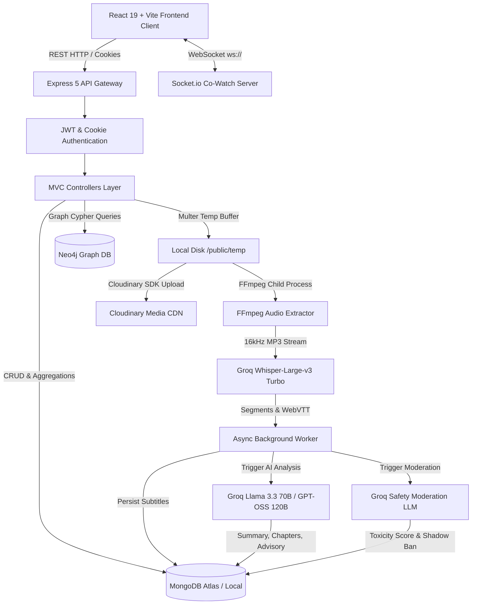
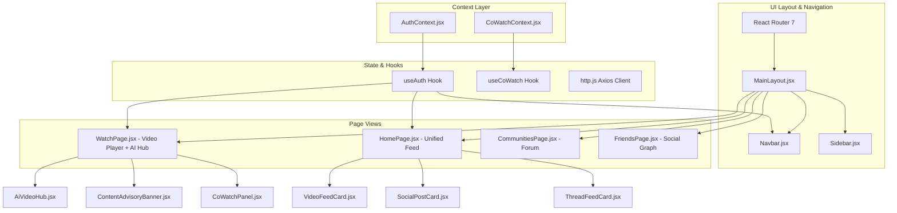

# Orbit Platform — Comprehensive Technical Implementation & Architecture Document

> **Document Purpose:** This document provides an exhaustive, self-contained technical specification of the Orbit codebase for an independent Large Language Model (LLM) or engineering team. It covers all architectural decisions, data models, algorithm implementations, asynchronous AI workflows, graph database mechanics, real-time protocols, API contracts, and testing frameworks without requiring access to the original source code.

---

## 1. System Overview & High-Level Architecture

### 1.1 Product Vision
**Orbit** is a full-stack, distributed social media and multimedia streaming platform that synthesizes the core paradigms of **YouTube** (video uploads, HLS/progressive streaming, channel subscriptions, watch history, and AI transcripts), **Twitter/X** (microblogging, short-form posts/tweets, mutual social graphs, and feed distribution), and **Reddit** (threaded community discussions, flair taxonomy, upvote/downvote algorithms, and community moderation), unified by a **real-time synchronous Co-Watching system** (WebSockets) and an **asynchronous AI intelligence engine** (audio extraction, Groq Whisper transcription, multi-task LLM content analysis, RAG copilot, and automated shadow-ban moderation).

### 1.2 Architectural Paradigm
Orbit uses a **Dual-Database Polyglot Architecture** combined with an **MVC API Service Layer** and an **Event-Driven Background Processing Engine**:
1. **Primary Persistence & Document Store:** **MongoDB (via Mongoose 8)** handles documents, entity metadata, user accounts, video metadata, comments, tweets, playlists, and aggregate pagination.
2. **Graph Relationship Store:** **Neo4j 5+ (via Bolt Driver)** manages high-degree social graph traversals: directional follower graphs (`:FOLLOWS`), bidirectional mutual friendships (`:FRIEND`, `:FRIEND_WITH`), community memberships (`:MEMBER_OF`), and access-control blocks (`:BLOCKS`).
3. **Real-Time Synchronous Transport:** **Socket.io 4** orchestrates real-time virtual rooms for synchronized video playback (play/pause/seek) and live chat.
4. **Asynchronous Background Processing:** Uses Node.js non-blocking process dispatch (`setImmediate`) to offload heavy audio extraction (FFmpeg) and cloud LLM inference (Groq SDK) without stalling HTTP request/response loops.
5. **Media Storage & Global CDN:** **Cloudinary** handles cloud storage, progressive delivery, and format transcoding for avatars, cover banners, video streams, and thumbnails.
6. **Frontend Single Page Application (SPA):** Built with **React 19**, **Vite 7**, **TailwindCSS 3.4**, and **React Router 7**, featuring headless authentication routing, infinite scroll with Intersection Observers, and reactive WebSocket sync hooks.



---

## 2. Technology Stack & Runtime Specifications

| Layer | Technologies & Libraries | Version & Configuration Details |
| :--- | :--- | :--- |
| **Runtime Environment** | Node.js (ES Modules `type: "module"`), macOS/Linux | Node 20+, zsh/bash, Native Child Process Execution |
| **Backend Framework** | Express.js | `^5.1.0`, Custom `asyncHandler`, Standardized JSON responses |
| **Document Database** | MongoDB Atlas & Local, Mongoose ODM | `mongoose ^8.18.3`, `mongoose-aggregate-paginate-v2 ^1.1.4` |
| **Graph Database** | Neo4j Community / Aura, Bolt Protocol | `neo4j-driver ^6.2.0`, `disableLosslessIntegers: true`, pool size: 50–100 |
| **Real-Time WebSockets**| Socket.io | Server `^4.8.4`, Client `^4.8.4`, CORS credentialed |
| **AI Inference & LLM** | Groq Cloud SDK | `groq-sdk ^1.6.0`, Whisper Large v3, Llama 3.3 70B Versatile, GPT-OSS 120B |
| **Audio/Video Processing**| FFmpeg, Fluent-FFmpeg, FFmpeg-static | `fluent-ffmpeg ^2.1.3`, `ffmpeg-static ^5.3.0`, Libmp3lame 16kHz Mono |
| **Cloud Storage** | Cloudinary SDK v2, Multer Disk Storage | `cloudinary ^2.8.0`, `multer ^2.0.2`, Disk storage in `/public/temp` |
| **Authentication & Auth** | JSON Web Tokens, Bcrypt | `jsonwebtoken ^9.0.2`, `bcrypt ^6.0.0` / `bcryptjs`, HttpOnly Cookies |
| **Frontend Framework** | React 19, Vite 7 | `react ^19.2.0`, `vite ^7.2.4`, `react-router-dom ^7.12.0` |
| **Styling & Icons** | Tailwind CSS, Lucide React | `tailwindcss ^3.4.17`, `lucide-react ^0.562.0` |
| **HTTP Client** | Axios | `axios ^1.6.8`, Request Interceptors, 401 Refresh Queue |

---

## 3. Directory Layout & Module Breakdown

```
miniproject/
├── core-modules/                 # Standalone core algorithmic & functional reference modules
│   ├── authSecurity.js           # Password hashing, JWT generation/verification, cookie options
│   ├── communityThreads.js       # O(N) hierarchical tree reconstruction for nested discussions
│   ├── cowatchSync.js            # In-memory WebSocket room sync logic and state machines
│   ├── feedRanking.js            # Engagement scoring, affinity weighting, time-decay ranking
│   ├── graphRecommendation.js    # Cypher queries for mutual friends & 2nd-degree recommendations
│   ├── mediaUpload.js            # Multer disk staging & Cloudinary streaming wrapper
│   ├── transcriptionWorker.js    # FFmpeg audio downsampling & Groq Whisper pipeline
│   ├── videoAnalysis.js          # Groq multi-task prompt: TL;DR, key takeaways, smart chapters
│   ├── videoCopilot.js           # RAG retrieval prompt over timestamped segments
│   ├── videoModeration.js        # Toxic content scoring, category flags, advisory extraction
│   └── videoRanking.js           # YouTube-style engagement score with exponential recency decay
│
├── Orbit-backend/                # Complete Express 5 Production Backend
│   ├── scripts/                  # Administrative maintenance & sync scripts
│   │   ├── bulkReanalyzeAll.js   # Batch migration script to backfill AI analysis on all videos
│   │   ├── populateFriends.js    # Seeding mutual friendship graph edges
│   │   └── syncNeo4j.js          # Full reconciliation script: syncs Mongo users/comms to Neo4j
│   ├── seed.js                   # Populates movie character users, communities, memberships
│   ├── src/
│   │   ├── app.js                # Express app setup, CORS, JSON parsers, route mounting, 404 & error handlers
│   │   ├── index.js              # Server bootstrapper, HTTP Server wrapping, Socket.io attach, DB connections
│   │   ├── constants.js          # System constants (e.g. DB_NAME = "videotube")
│   │   ├── config/
│   │   │   └── neo4j.config.js   # Neo4j driver instantiation, pool configuration, connection lifecycle
│   │   ├── db/
│   │   │   └── index.js          # Mongoose connection initializer with error traps
│   │   ├── models/               # 14 Mongoose Schema Definitions
│   │   │   ├── user.model.js, video.model.js, tweet.model.js, comment.model.js,
│   │   │   ├── like.model.js, playlist.model.js, subscription.model.js,
│   │   │   ├── community.model.js, communityMembership.model.js, thread.model.js,
│   │   │   ├── threadVote.model.js, friendRequest.model.js, notification.model.js, report.model.js
│   │   ├── controllers/          # 17 MVC Business Logic Handlers
│   │   │   ├── ai.controller.js, comment.controller.js, community.controller.js,
│   │   │   ├── dashboard.controller.js, explore.controller.js, feed.controller.js,
│   │   │   ├── friend.controller.js, graph.controller.js, like.controller.js,
│   │   │   ├── notification.controller.js, playlist.controller.js, recommendation.controller.js,
│   │   │   ├── subscription.controller.js, thread.controller.js, tweet.controller.js,
│   │   │   ├── user.controller.js, video.controller.js
│   │   ├── routes/               # Express Router declarations matching controllers
│   │   ├── middlewares/
│   │   │   ├── auth.middleware.js   # JWT validation, extraction from Bearer header or cookie
│   │   │   └── multer.middleware.js # Multi-part form staging to public/temp
│   │   ├── services/
│   │   │   ├── ai/               # Groq LLM analysis & RAG chatbot service implementations
│   │   │   ├── graph/            # Cypher queries, BFS shortest path, DFS traversal, Feed generation
│   │   │   ├── moderation/       # Content safety classification, toxicity evaluation, shadow banning
│   │   │   ├── recommendation/   # TF-IDF NLP vectorizer, Cosine Similarity, Jaccard friend scoring
│   │   │   ├── transcription/    # FFmpeg subprocess management, Groq Whisper API integration
│   │   │   └── ranking.service.js# Reddit/HackerNews Hot sorting aggregation pipelines
│   │   ├── socket/
│   │   │   └── cowatch.socket.js # Real-time Co-Watch room manager, host failover, broadcast sync
│   │   └── utils/
│   │       ├── ApiError.js       # Standardized operational Error subclass
│   │       ├── ApiResponse.js    # Uniform JSON response envelope
│   │       ├── asyncHandler.js   # High-order wrapper catching Promise rejections
│   │       └── cloudinary.js     # Cloudinary upload, disk cleanup, secure URL resolution
│
├── Orbit-frontend/               # React 19 Client SPA
│   ├── src/
│   │   ├── App.jsx               # Client route tree, ProtectedRoute guards, AuthRoute wrappers
│   │   ├── main.jsx              # React DOM root render, Context provider injection
│   │   ├── api/                  # Modular Axios wrappers for every backend endpoint
│   │   │   ├── http.js           # Axios instance with Bearer interceptor & refresh queue
│   │   │   └── *.api.js          # Specialized endpoints (ai, video, feed, community, friend, etc.)
│   │   ├── context/
│   │   │   ├── AuthContext.jsx   # Current user state, login, register, logout, auto-refresh
│   │   │   └── CoWatchContext.jsx# WebSocket connection, room state, sync player control, suppress echo
│   │   ├── hooks/                # Custom React hooks (useAuth, useCoWatch, useVideos, etc.)
│   │   ├── layouts/
│   │   │   └── MainLayout.jsx    # Persistent Navbar, Collapsible Sidebar, Responsive viewport shell
│   │   ├── pages/                # 21 Application Screen Views (Home, Watch, Channel, Communities, etc.)
│   │   └── components/           # UI Component hierarchy
│   │       ├── video/            # AiVideoHub, ContentAdvisoryBanner, VideoCard, VideoPlayer
│   │       ├── cowatch/          # CoWatchPanel, CoWatchModal, CoWatchNavButton
│   │       ├── feed/             # VideoFeedCard, SocialPostCard, ThreadFeedCard, CreatePostBox
│   │       ├── community/        # Community members, community settings modal
│   │       └── layout/           # Navbar, Sidebar, ProtectedRoute
│
├── tests/                        # Comprehensive Module Test Harness & Automated Reporting
│   ├── runAllTests.js            # Runner executing 4 suites, HTML generator, headless Chrome screenshot
│   ├── videoRanking.functional.test.js
│   ├── videoRanking.nonFunctional.test.js
│   ├── feedRanking.functional.test.js
│   └── feedRanking.nonFunctional.test.js
└── scripts/
    └── stressTestGraph.js        # Concurrency stress tester for Neo4j mutual friend & 2nd-degree queries
```

---

## 4. Database Architecture & Data Models

### 4.1 MongoDB / Mongoose Collections

#### 1. User (`users`)
* Primary identity and credential store.
* **Fields:**
  * `username` (String, required, unique, lowercase, trimmed, indexed)
  * `email` (String, required, unique, lowercase, trimmed)
  * `fullName` (String, required, trimmed, indexed)
  * `avatar` (String, Cloudinary CDN URL, required)
  * `coverImage` (String, Cloudinary CDN URL, optional)
  * `password` (String, bcrypt hash with 10 salt rounds)
  * `refreshToken` (String, active refresh JWT)
  * `watchHistory` (Array of `ObjectId` referencing `Video`)
  * `timestamps` (`createdAt`, `updatedAt`)
* **Hooks & Methods:**
  * `pre("save")`: Hashes `password` using `bcrypt.hash(..., 10)` if modified.
  * `isPasswordCorrect(plainPassword)`: Returns `bcrypt.compare`.
  * `generateAccessToken()`: Signs payload `({ _id, email, username, fullName })` with `ACCESS_TOKEN_SECRET` (expiry: `1d`).
  * `generateRefreshToken()`: Signs payload `({ _id })` with `REFRESH_TOKEN_SECRET` (expiry: `10d`).

#### 2. Video (`videos`)
* Rich multimedia record storing video assets, playback metrics, and AI metadata.
* **Fields:**
  * `videoFile` (String, Cloudinary video URL)
  * `thumbnail` (String, Cloudinary image URL)
  * `title` (String, required)
  * `description` (String, required)
  * `duration` (Number, length in seconds)
  * `views` (Number, total view count, default: 0)
  * `viewedBy` (Array of `ObjectId` referencing `User` for unique viewer tracking)
  * `isPublished` (Boolean, default: true)
  * `owner` (`ObjectId` referencing `User`, indexed)
  * `transcript` (String, raw full-text transcription from Whisper)
  * `caption_vtt` (String, fully formatted WebVTT subtitle track)
  * `transcription_status` (Enum: `["pending", "processing", "completed", "failed"]`, default: `"pending"`, indexed)
  * `transcription_error` (String, nullable)
  * `segments` (Array of sub-documents: `[{ start: Number, end: Number, text: String }]`)
  * `aiAnalysis`:
    * `tldr` (String, 2-sentence executive summary)
    * `keyPoints` (Array of Strings, 3–5 bullet takeaways)
    * `chapters` (Array: `[{ timestamp: Number, formattedTime: String, title: String }]`)
    * `analysisStatus` (Enum: `["pending", "processing", "completed", "failed"]`)
  * `aiAdvisory`:
    * `hasAdvisory` (Boolean, default: false)
    * `category` (Enum: `["medical", "financial", "legal", "pseudoscience", "conspiracy", "spiritual_religious", "nutrition_supplement", "safety_security", "political_misinformation", "environmental_misinformation", "none"]`)
    * `riskLevel` (Enum: `["high", "medium", "low", "none"]`)
    * `disclaimerTitle` (String, nullable)
    * `disclaimerMessage` (String, nullable)
  * `isShadowBanned` (Boolean, default: false, indexed — excluded from feeds when true)
  * `toxicityScore` (Number, 0.00 to 1.00)
  * `isVulgar` (Boolean, default: false)
  * `flaggedCategories` (Array of Strings)
  * `moderationStatus` (Enum: `["pending", "processing", "completed", "failed"]`)
  * `moderatedAt` (Date)
* **Plugins:** `mongoose-aggregate-paginate-v2` for cursor/page pagination.

#### 3. Community (`communities`)
* Reddit-style subreddit equivalent.
* **Fields:**
  * `name` (String, required)
  * `slug` (String, unique, lowercase, trimmed)
  * `description` (String)
  * `avatar` (String)
  * `banner` (String)
  * `creator` (`ObjectId` referencing `User`)
  * `rules` (Array of Strings)
  * `privacy` (Enum: `["PUBLIC", "RESTRICTED", "PRIVATE"]`, default: `"PUBLIC"`)
  * `memberCount` (Number, default: 1)

#### 4. CommunityMembership (`communitymemberships`)
* Joins users to communities with role-based access control.
* **Fields:**
  * `userId` (`ObjectId` referencing `User`, indexed)
  * `communityId` (`ObjectId` referencing `Community`, indexed)
  * `role` (Enum: `["OWNER", "MODERATOR", "MEMBER"]`, default: `"MEMBER"`)
  * `status` (Enum: `["PENDING", "APPROVED", "BANNED"]`, default: `"APPROVED"`)
* **Compound Index:** `{ userId: 1, communityId: 1 }` (unique constraint).

#### 5. Thread (`threads`)
* Forum discussions posted inside communities.
* **Fields:**
  * `communityId` (`ObjectId` referencing `Community`, indexed)
  * `authorId` (`ObjectId` referencing `User`, indexed)
  * `title` (String, required)
  * `body` (String)
  * `media` (Array of Strings)
  * `flair` (String)
  * `score` (Number, upvotes minus downvotes, default: 0)
  * `commentCount` (Number, default: 0)
  * `isModeratorRemoved` (Boolean, default: false)

#### 6. ThreadVote (`threadvotes`)
* Tracks individual user up/down votes on threads.
* **Fields:**
  * `threadId` (`ObjectId` referencing `Thread`, indexed)
  * `userId` (`ObjectId` referencing `User`, indexed)
  * `value` (Number, `1` for upvote, `-1` for downvote)
* **Compound Index:** `{ threadId: 1, userId: 1 }` (unique constraint).

#### 7. Tweet / Social Post (`tweets`)
* Microblogging post (Twitter style).
* **Fields:**
  * `owner` (`ObjectId` referencing `User`, required, indexed)
  * `content` (String, required)

#### 8. Comment (`comments`)
* Dual-purpose commenting model supporting both flat video comments and nested thread comments.
* **Fields:**
  * `content` (String, required)
  * `owner` (`ObjectId` referencing `User`, required)
  * `video` (`ObjectId` referencing `Video`, optional)
  * `thread` (`ObjectId` referencing `Thread`, optional)
  * `parentComment` (`ObjectId` referencing `Comment`, nullable for nested tree replies)
  * `isModeratorRemoved` (Boolean, default: false)

#### 9. Like (`likes`)
* Polymorphic like model.
* **Fields:**
  * `likedBy` (`ObjectId` referencing `User`, required)
  * `video` (`ObjectId` referencing `Video`, optional)
  * `comment` (`ObjectId` referencing `Comment`, optional)
  * `tweet` (`ObjectId` referencing `Tweet`, optional)

#### 10. Subscription (`subscriptions`)
* YouTube-style channel follow model.
* **Fields:**
  * `subscriber` (`ObjectId` referencing `User`, the follower)
  * `channel` (`ObjectId` referencing `User`, creator being followed)

#### 11. FriendRequest (`friendrequests`)
* Two-phase social relationship management.
* **Fields:**
  * `sender` (`ObjectId` referencing `User`, required)
  * `receiver` (`ObjectId` referencing `User`, required)
  * `status` (Enum: `["PENDING", "ACCEPTED", "REJECTED"]`, default: `"PENDING"`)
* **Compound Index:** `{ sender: 1, receiver: 1 }` (unique constraint).

#### 12. Playlist (`playlists`)
* Custom video collections.
* **Fields:**
  * `name` (String, required)
  * `description` (String)
  * `videos` (Array of `ObjectId` referencing `Video`)
  * `owner` (`ObjectId` referencing `User`)

#### 13. Notification (`notifications`)
* Alerts for social actions.
* **Fields:**
  * `recipient` (`ObjectId` referencing `User`, indexed)
  * `sender` (`ObjectId` referencing `User`)
  * `type` (Enum: `["FRIEND_REQUEST", "FRIEND_ACCEPT", "LIKE", "COMMENT", "MENTION"]`)
  * `message` (String)
  * `isRead` (Boolean, default: false)

#### 14. Report (`reports`)
* User reporting pipeline for moderation.
* **Fields:**
  * `reporter` (`ObjectId` referencing `User`)
  * `targetId` (`ObjectId`)
  * `targetType` (Enum: `["Thread", "Comment"]`)
  * `communityId` (`ObjectId` referencing `Community`)
  * `reason` (String)
  * `status` (Enum: `["PENDING", "RESOLVED", "DISMISSED"]`, default: `"PENDING"`)

---

### 4.2 Neo4j Graph Model & Cypher Schema

Neo4j models the high-dimensional social topology to avoid complex, slow recursive joins in MongoDB.

#### Node Labels:
1. `(:User { mongoId: String, username: String, name: String, avatar: String })`
2. `(:Community { mongoId: String, name: String, slug: String, description: String })`

#### Relationships:
1. `(u1:User)-[:FRIEND { createdAt: Datetime }]->(u2:User)`: Reciprocal friendship (created symmetrically in both directions upon accepting a request).
2. `(u1:User)-[:FRIEND_WITH { createdAt: Datetime }]->(u2:User)`: Undirected semantic friendship alias.
3. `(u1:User)-[:FOLLOWS { createdAt: Datetime }]->(u2:User)`: Unidirectional subscription / follow.
4. `(u:User)-[:MEMBER_OF { joinedAt: Datetime }]->(c:Community)`: User joined community.
5. `(u1:User)-[:BLOCKS { createdAt: Datetime }]->(u2:User)`: Explicit user block.

#### Constraints:
```cypher
CREATE CONSTRAINT user_id_unique IF NOT EXISTS FOR (u:User) REQUIRE u.mongoId IS UNIQUE;
CREATE CONSTRAINT community_id_unique IF NOT EXISTS FOR (c:Community) REQUIRE c.mongoId IS UNIQUE;
```

---

## 5. Core Algorithms & Mathematical Formulations

### 5.1 Video Ranking Engine (`core-modules/videoRanking.js`)
Calculates an engagement score modulated by an exponential half-life recency decay:

$$\text{ageInDays} = \frac{\text{Date.now}() - \text{createdAt}}{1000 \times 60 \times 60 \times 24}$$

$$\text{recencyFactor} = 0.5^{\frac{\text{ageInDays}}{7}} \quad (\text{Half-life of 7 days})$$

$$\text{avgWatchRatio} = \begin{cases} 
\min\left(1.0, \frac{\text{totalWatchTime}}{\text{views} \times \text{duration}}\right) & \text{if } \text{views} > 0 \text{ and } \text{duration} > 0 \\
0.5 & \text{otherwise}
\end{cases}$$

$$\text{engagementScore} = (\text{views} \times 0.2) + (\text{likesCount} \times 1.0) + (\text{commentsCount} \times 2.5) + (\text{avgWatchRatio} \times 50)$$

$$\text{Final Video Score} = \text{engagementScore} \times \text{recencyFactor}$$

* **Weights Rationale:** Comments ($2.5$) and watch retention ($50 \times \text{ratio}$) are weighted far higher than passive views ($0.2$) to reward high-retention content.

---

### 5.2 Heterogeneous Feed Ranking Algorithm (`core-modules/feedRanking.js` & `src/services/graph/feedRanking.service.js`)
Used to score heterogeneous items (Videos, Posts, Threads) in the unified home feed:

$$\text{ageInHours} = \max\left(0.1, \frac{\text{Date.now}() - \text{createdAt}}{1000 \times 60 \times 60}\right)$$

$$\text{relationshipWeight} = \begin{cases} 3.0 \text{ (or } 2.0 \text{ in backend service)} & \text{if author is a Friend} \\ 1.2 \text{ (or } 1.0) & \text{otherwise} \end{cases}$$

$$\text{communityWeight} = \begin{cases} 2.5 \text{ (or } 1.3) & \text{if user is a member of community} \\ 1.0 & \text{otherwise} \end{cases}$$

For videos, raw views are log-dampened to prevent view numbers from overwhelming forum upvotes:
$$\text{normalizedScore}(\text{video}) = \log_{10}(\max(1, \text{views})) \times 10$$

#### Time-Decay Gravity Formulations:
* **HackerNews-Style Decay (Backend Feed):**
  $$\text{Final Score} = \frac{(\text{Score} + 1) \times \text{Multiplier}}{(\text{ageInHours} + 2)^{1.5}}$$
* **Exponential Decay (`core-modules/feedRanking.js`):**
  $$\text{timeDecay} = e^{-0.05 \times \text{ageInHours}}$$
  $$\text{Final Score} = (\text{engagementScore} + 1) \times \text{relationshipWeight} \times \text{communityWeight} \times \text{timeDecay}$$

---

### 5.3 Thread "Hot" Ranking (`src/services/ranking.service.js`)
Implements Reddit/HackerNews gravity scoring natively inside MongoDB Aggregation pipelines:

$$\text{hotness} = \frac{\max(\text{score}, 0)}{(\text{ageInHours} + 2)^{1.8}}$$

* Computed on the fly via `$addFields` and sorted descending with `{ $sort: { hotness: -1 } }`.

---

### 5.4 Hybrid Content & Social Video Recommendation (`src/services/recommendation/`)
Combines natural language processing (NLP) content similarity with social graph activity.

1. **Text Preprocessing & TF-IDF Vectorization (`nlp.service.js`):**
   * Tokenization, lowercasing, punctuation stripping, stopword removal.
   * Term Frequency: $\text{TF}(t, d) = \frac{\text{count}(t, d)}{|d|}$.
   * Inverse Document Frequency: $\text{IDF}(t, D) = \log\left(\frac{1 + |D|}{1 + \text{DF}(t, D)}\right) + 1$.
   * TF-IDF Vector: $\vec{V}_d(t) = \text{TF}(t, d) \times \text{IDF}(t, D)$.
2. **Content Similarity ($S_c$):**
   Cosine similarity between target video vector $\vec{A}$ and candidate vector $\vec{B}$:
   $$S_c = \frac{\vec{A} \cdot \vec{B}}{\|\vec{A}\| \|\vec{B}\|} = \frac{\sum A_i B_i}{\sqrt{\sum A_i^2} \sqrt{\sum B_i^2}}$$
3. **Graph Score ($S_g$):**
   Calculated by querying Neo4j for network interactions on the candidate video by mutual friends.
4. **Min-Max Normalization:**
   $$\text{norm}(S) = \frac{S - S_{\min}}{S_{\max} - S_{\min}} \quad (\text{bounded to } [0, 1])$$
5. **Hybrid Score Fusion:**
   $$R = (w_G \times \text{norm}(S_g)) + (w_C \times \text{norm}(S_c)) \quad (w_G = 0.60, w_C = 0.40)$$

---

### 5.5 Graph Algorithms & Social Distance (`src/services/graph/`)
1. **Shortest Path BFS (`bfs.service.js`):**
   Uses Cypher's native breadth-first search engine:
   ```cypher
   MATCH (start:User {mongoId: $startUserId}), (end:User {mongoId: $targetUserId})
   MATCH p = shortestPath((start)-[:FRIEND*1..6]-(end))
   RETURN [x IN nodes(p) | x.mongoId] AS path
   ```
2. **Depth-First Search (DFS) Traversal (`dfs.service.js`):**
   ```cypher
   MATCH p = (start:User {mongoId: $startUserId})-[:FRIEND*1..6]-(end:User)
   RETURN [x IN nodes(p) | x.mongoId] AS path LIMIT 100
   ```
3. **Friend-of-Friend (FoF) Recommendations (`userRecommendation.service.js`):**
   Traverses 2-hop edges across `:FRIEND` and `:MEMBER_OF`, ranking candidates by:
   $$\text{Score} = (\text{mutualFriendsCount} \times 2.0) + (\text{mutualCommunitiesCount} \times 1.0)$$

---

### 5.6 Community Discussion Tree Reconstruction (`core-modules/communityThreads.js`)
Reconstructs an arbitrary multi-level nested discussion tree from a flat array in $O(N)$ time:
* Uses a `Map<string, Node>` hash index.
* Single pass initializes nodes with empty `.replies = []`.
* Second pass links `node` into `parent.replies` if `parentId` exists in map; otherwise appends to `rootItems`.

---

## 6. Asynchronous Media & AI Intelligence Pipelines

```mermaid
sequenceDiagram
    autonumber
    actor User as Client
    participant Express as Video Controller
    participant Cloudinary as Cloudinary CDN
    participant Disk as Local Temp Disk
    participant Worker as Transcription Worker
    participant FFmpeg as FFmpeg Static
    participant GroqWhisper as Groq Whisper Large v3
    participant Mongo as MongoDB
    participant GroqLLM as Groq Llama 3.3 / GPT-OSS

    User->>Express: POST /api/v1/videos (Multer multipart form)
    Express->>Disk: Buffer video & thumbnail to /public/temp
    Express->>Cloudinary: Upload videoFile (deleteAfterUpload: false)
    Express->>Cloudinary: Upload thumbnail (deleteAfterUpload: true)
    Express->>Mongo: Create Video (transcription_status: "pending")
    Express-->>User: 201 Created (Video document returned immediately)

    Note over Express,Worker: Non-blocking setImmediate()
    Express->)Worker: processVideoTranscription(videoId, videoLocalPath)

    Worker->>Mongo: Update status to "processing"
    Worker->>FFmpeg: Downsample audio (16kHz mono MP3)
    FFmpeg->>Disk: Output temp .mp3 audio file
    Worker->>GroqWhisper: Stream MP3 to whisper-large-v3
    GroqWhisper-->>Worker: Verbose JSON (Text + Timestamped Segments)
    Worker->>Worker: Generate WebVTT string & subtitle track
    Worker->>Mongo: Update Video (transcript, caption_vtt, segments, status: "completed")
    Worker->>Disk: Unlink temporary video & audio files

    par Concurrent Post-Processing
        Worker->)GroqLLM: analyzeVideoById() -> TL;DR, Key Takeaways, Chapters, Advisory
        GroqLLM-->>Mongo: Update Video (aiAnalysis, aiAdvisory)
    and
        Worker->)GroqLLM: moderateVideoById() -> Toxicity Score, Category Flags, Shadow Ban
        GroqLLM-->>Mongo: Update Video (isShadowBanned, toxicityScore, flaggedCategories)
    end
```

### 6.1 Audio Downsampling Protocol (`audioExtractor.service.js`)
* Executes command:
  ```bash
  ffmpeg -y -i "{sourceMedia}" -vn -acodec libmp3lame -ar 16000 -ac 1 "{tempAudioPath}"
  ```
* `-vn`: Strips video stream completely.
* `-acodec libmp3lame`: Encodes to lightweight MP3.
* `-ar 16000`: Downsamples to 16 kHz (Whisper's native audio sample rate).
* `-ac 1`: Converts multi-channel audio into single-channel mono.

### 6.2 Multi-Task Content Intelligence Prompt (`videoAnalysis.service.js`)
* **Prompt Optimization:** Long transcripts are window-bucketed evenly across time (sampling ~50 anchor points) to strictly stay below Groq's 12,000 character (~3,000 token) rate limit.
* **Output Format:** Strict JSON output validated against:
  * `tldr`: 2-sentence summary.
  * `keyPoints`: Array of 3–5 bullet points.
  * `chapters`: Array of `{ timestamp: integer, formattedTime: "MM:SS", title: string }`.
  * `advisory`: `{ hasAdvisory: boolean, category: string, riskLevel: string, disclaimerTitle: string, disclaimerMessage: string }`.

### 6.3 Content Safety & Shadow Banning (`videoModeration.service.js`)
* Evaluates 14 harm categories: `hate_speech`, `extreme_profanity`, `vulgarity`, `harassment_bullying`, `threats_violence`, `self_harm_promotion`, `dangerous_challenges`, `radicalization_extremism`, `scam_fraud`, `dangerous_misinformation`, `child_safety`, `animal_cruelty`, `privacy_doxxing`, `weapons_illegal_activity`.
* **Shadow Ban Thresholds:**
  * `toxicityScore >= 0.70`
  * OR any presence of severe categories (`child_safety`, `hate_speech`, `threats_violence`, `self_harm_promotion`, `radicalization_extremism`, `dangerous_misinformation`, `scam_fraud`).
  * When `isShadowBanned: true`, the video is silently omitted from home feeds, explore feeds, and recommendation algorithms (`{ isShadowBanned: { $ne: true } }`).

### 6.4 RAG Video Copilot (`videoChatbot.service.js`)
* Allows users to ask natural-language questions about video content during playback.
* **Retrieval Mechanism:**
  1. Tokenizes user question into significant keywords.
  2. Scores all transcript segments against keyword matches.
  3. Extracts top matching segments with $\pm 1$ neighbor context windows.
  4. If query is generic, evenly samples the video timeline.
* **System Prompt:** Instructs the LLM to act as "Orbit Copilot", answer strictly based on the provided timestamped transcript, state if information is missing, and provide exact `[MM:SS]` timestamps which the React UI parses into clickable seek buttons.

---

## 7. Real-Time Co-Watching Protocol & WebSockets

### 7.1 Architecture & Room State Machine (`cowatch.socket.js`)
* **Room Code:** 6-character alphanumeric code generated using base-32 character set `ABCDEFGHJKLMNPQRSTUVWXYZ23456789` (avoids ambiguous characters like `0`, `O`, `1`, `I`).
* **In-Memory Store:**
  ```javascript
  rooms.set(roomCode, {
    hostId: socket.id,
    videoId: string,
    videoTitle: string,
    members: [{ socketId: string, username: string, avatar: string }]
  });
  ```
* **Host Failover:** If the host's socket disconnects, the room automatically promotes the oldest remaining member to `hostId` and broadcasts `member_left` with `newHostId`. When all members disconnect, the room is deleted from memory.

### 7.2 WebSocket Event Contract

| Event Name | Direction | Payload Schema | Functional Behavior |
| :--- | :--- | :--- | :--- |
| `create_room` | Client $\to$ Server | `{ username, avatar, videoId, videoTitle }` | Initializes room, sets sender as host, joins socket room channel |
| `room_created`| Server $\to$ Client | `{ roomCode }` | Confirms room code to creator |
| `join_room` | Client $\to$ Server | `{ roomCode, username, avatar }` | Validates code, registers member, joins channel, sends full state |
| `room_state` | Server $\to$ Client | `{ roomCode, members, hostId, videoId, videoTitle }` | Delivers full room snapshot; syncs video navigation |
| `video_changed`| Server $\to$ Client | `{ videoId, videoTitle }` | Navigates all non-host members to `/watch/:videoId` |
| `sync` | Bidirectional | `{ type: 'play'\|'pause'\|'seek', time, fromSocketId }` | Replicates media controls across all peer players in room |
| `chat_message`| Bidirectional | `{ id, username, avatar, text, at: timestamp }` | Broadcasts real-time chat messages to all room members |
| `leave_room` | Client $\to$ Server | `{ roomCode }` | Manually disconnects member; triggers host reelection if needed |

### 7.3 Echo Loop Suppression (`CoWatchContext.jsx`)
A critical engineering challenge in synchronized web video playback is the **infinite event echo**:
1. Server receives a `play` action from Host.
2. Server broadcasts `sync` (`type: 'play'`) to Viewers.
3. Viewer's browser executes `videoElement.play()`.
4. The `<video>` element's native `onPlay` event fires.
5. If unchecked, the viewer's `onPlay` handler would transmit another `sync` (`type: 'play'`) back to the server, creating an infinite broadcast loop.
* **The Solution:** A React ref flag `suppressSyncRef.current = true` is set immediately before programmatic playback control and reset in a microtask/`setTimeout(0)`. In `onPlay`/`onPause`, if `suppressSyncRef.current` is true, the outbound socket emit is suppressed.

---

## 8. Authentication, Security & Network Architecture

### 8.1 Dual-Token Authentication Flow
1. **Registration / Login:**
   * Validates credentials against MongoDB (`bcrypt.compare`).
   * Generates `accessToken` (1-day expiry) and `refreshToken` (10-day expiry).
   * Stores hashed `refreshToken` in MongoDB `users` collection.
   * Sets **HttpOnly, Secure, SameSite** cookies:
     ```javascript
     res.cookie("accessToken", accessToken, {
       httpOnly: true,
       secure: process.env.NODE_ENV === "production",
       sameSite: process.env.NODE_ENV === "production" ? "none" : "lax",
       maxAge: 24 * 60 * 60 * 1000
     });
     ```
   * Also returns tokens in JSON response body as a fallback for clients with restrictive cookie settings (saved to `localStorage`).

### 8.2 Token Refresh Queue Pattern (`Orbit-frontend/src/api/http.js`)
Prevents request race conditions and infinite redirection loops when access tokens expire:
* Axios request interceptor injects `Authorization: Bearer <token>` from `localStorage` if available.
* Axios response interceptor intercepts `401 Unauthorized`:
  1. If request was already retried (`_retry: true`) or target was auth endpoints (`/login`, `/register`, `/refresh-token`), rejects immediately.
  2. If a refresh is already in progress (`isRefreshing: true`), the failed request returns a `new Promise` appended to `failedQueue`.
  3. If first to fail, sets `isRefreshing = true` and `originalRequest._retry = true`.
  4. Calls `POST /api/v1/users/refresh-token` with `{ withCredentials: true }`.
  5. Updates `localStorage` with new tokens, resolves all queued requests via `processQueue()`, and replays original request.
  6. If refresh fails, flushes `failedQueue`, clears `localStorage`, and logs out user cleanly.

---

## 9. Comprehensive API Route Catalog

All routes are mounted under the base path `/api/v1`.

### 9.1 Authentication & User Routes (`/users`)
* `POST /users/register` (Public, multipart): `fullName`, `email`, `username`, `password`, `avatar` (file), `coverImage` (file).
* `POST /users/login` (Public): `email` or `username`, `password`.
* `POST /users/logout` (Auth required): Clears refresh token in DB and clears cookies.
* `POST /users/refresh-token` (Public / Cookie): Validates refresh token, issues new token pair.
* `POST /users/change-password` (Auth required): `oldPassword`, `newPassword`.
* `GET /users/current-user` (Auth required): Returns current authenticated user record.
* `PATCH /users/update-account` (Auth required): `fullName`, `email`.
* `PATCH /users/avatar` (Auth required, multipart): `avatar` (file).
* `PATCH /users/cover-image` (Auth required, multipart): `coverImage` (file).
* `GET /users/c/:username` (Auth required): Channel profile with subscriber counts and subscription status.
* `GET /users/history` (Auth required): User's watched video history with populated channels.
* `GET /users/search` (Auth required): Query param `?q=username` for friend/user discovery.

### 9.2 Video Routes (`/videos`)
* `GET /videos` (Public): Query params `?page=1&limit=10&query=&sortBy=createdAt&sortType=desc`. Returns published, unbanned videos.
* `POST /videos` (Auth required, multipart): `title`, `description`, `videoFile` (file), `thumbnail` (file).
* `GET /videos/:videoId` (Public / Optional Auth): Returns video metadata, subtitle tracks, AI analysis, advisory notices, owner details, like/subscription state. Increments view and updates watch history if authenticated.
* `PATCH /videos/:videoId` (Auth required, multipart): `title`, `description`, `thumbnail` (file).
* `DELETE /videos/:videoId` (Auth required): Deletes video record from DB and media assets.
* `PATCH /videos/toggle/publish/:videoId` (Auth required): Inverts `isPublished`.
* `GET /videos/user/videos` (Auth required): Videos owned by authenticated creator.
* `GET /videos/recommendations/:videoId` (Auth required): Returns hybrid TF-IDF + social recommendations.
* `GET /videos/:videoId/subtitles.vtt` (Public): Raw WebVTT subtitle stream.
* `POST /videos/:videoId/moderate` (Auth required): Manually triggers content safety audit.

### 9.3 AI Intelligence Routes (`/ai`)
* `GET /ai/analysis/:videoId` (Public): Returns `aiAnalysis` (TL;DR, keyPoints, chapters) and `aiAdvisory`.
* `GET /ai/transcript/:videoId` (Public): Returns raw timestamped segments for interactive transcript.
* `POST /ai/chat/:videoId` (Auth required): Body: `{ question, conversationHistory }`. RAG-based video copilot.
* `POST /ai/analyze/:videoId` (Auth required, owner only): Dispatches full re-analysis and transcription.

### 9.4 Social Graph & Friendship Routes (`/friends` & `/users`)
* `POST /friends/request/:userId` (Auth required): Dispatches friend request; checks block rules in Neo4j.
* `POST /friends/request/:requestId/accept` (Auth required): Accepts request; synchronizes `:FRIEND` edges to Neo4j.
* `POST /friends/request/:requestId/reject` (Auth required): Rejects pending request.
* `DELETE /friends/request/:requestId` (Auth required): Cancels outbound pending request.
* `DELETE /friends/:userId` (Auth required): Unfriends user; removes Neo4j `:FRIEND` edges.
* `GET /friends` (Auth required): Returns all accepted friends.
* `GET /friends/requests` (Auth required): Returns pending inbound and outbound friend requests.
* `GET /users/:id/friends` (Auth required): Friends of target user via Neo4j.
* `GET /users/:id/followers` (Auth required): Subscribers of channel.
* `GET /users/:id/following` (Auth required): Channels subscribed to.
* `GET /users/:id/mutual-friends` (Auth required): Mutual friend intersection via Cypher query.
* `GET /users/:id/connection-path` (Auth required): Shortest connection path via BFS.

### 9.5 Communities & Threads Routes (`/communities` & `/threads`)
* `GET /communities` (Auth required): List public communities sorted by `memberCount`.
* `GET /communities/search` (Auth required): Search communities by query string.
* `GET /communities/:slug` (Auth required): Community profile and metadata.
* `POST /communities` (Auth required): Creates community; creates Neo4j node and `:MEMBER_OF` edge.
* `POST /communities/:id/join` (Auth required): Joins community; creates Neo4j `:MEMBER_OF` edge.
* `POST /communities/:id/leave` (Auth required): Leaves community; removes Neo4j `:MEMBER_OF` edge.
* `GET /communities/:id/members` (Auth required): List members and roles.
* `GET /threads/community/:communityId` (Public): Query params `?sort=hot|top|new`. Paginated community threads.
* `POST /threads/community/:communityId` (Auth required): Creates new thread.
* `GET /threads/:id` (Public): Thread details with populated author.
* `PATCH /threads/:id` (Auth required): Edit thread body/media.
* `DELETE /threads/:id` (Auth required): Delete thread (author or moderator).
* `POST /threads/:id/vote` (Auth required): Body: `{ value: 1 | -1 }`. Upvote/downvote.
* `DELETE /threads/:id/vote` (Auth required): Removes vote.
* `GET /threads/:id/comments` (Public): Nested comments tree.
* `POST /threads/:id/comments` (Auth required): Adds comment or reply (`parentCommentId`).
* `POST /threads/report` (Auth required): Submits moderation report for thread or comment.

### 9.6 Feeds, Recommendations & Dashboards (`/feed`, `/explore`, `/recommendations`, `/dashboard`)
* `GET /feed` (Auth required): Query param `?cursor=...`. Master unified heterogeneous feed.
* `GET /explore/feed` (Auth required): General discovery feed excluding followed creators.
* `GET /explore/highlights` (Auth required): Trending communities and popular creators.
* `GET /recommendations/users` (Auth required): 2-hop FoF user recommendations via Jaccard graph traversal.
* `GET /recommendations/communities` (Auth required): Recommended communities based on mutual member density.
* `GET /dashboard/stats` (Auth required): Channel analytics: total views, subscribers, total likes, video breakdown.
* `GET /dashboard/videos` (Auth required): Creator studio video management table.

### 9.7 Tweets, Likes, Playlists & Comments
* `POST /tweets`, `GET /tweets`, `GET /tweets/user/:userId`, `PATCH /tweets/:tweetId`, `DELETE /tweets/:tweetId`.
* `POST /likes/toggle/v/:videoId`, `POST /likes/toggle/c/:commentId`, `POST /likes/toggle/t/:tweetId`, `GET /likes/videos`.
* `POST /comments/:videoId`, `GET /comments/:videoId`, `PATCH /comments/c/:commentId`, `DELETE /comments/c/:commentId`.
* `POST /playlists`, `GET /playlists/user/:userId`, `GET /playlists/:playlistId`, `POST /playlists/add/:videoId/:playlistId`, `POST /playlists/remove/:videoId/:playlistId`.

---

## 10. Frontend Architecture & State Management



### 10.1 Key Frontend Components & Interaction Flow
1. **AiVideoHub (`src/components/video/AiVideoHub.jsx`):**
   * Tabbed workspace: **Summary** (TL;DR & bullet points), **Chapters** (timestamped topic blocks), **Transcript** (interactive searchable transcript with live active segment tracking), and **Chat** (RAG Copilot).
   * Seeking callback `onSeek(timestamp)` directly alters video playback position in `WatchPage`.
2. **ContentAdvisoryBanner (`src/components/video/ContentAdvisoryBanner.jsx`):**
   * Renders color-coded advisory notices for medical, financial, legal, and misinformation claims based on AI analysis.
   * Expandable modal explains "Why am I seeing this notice?".
3. **CoWatchPanel (`src/components/cowatch/CoWatchPanel.jsx`):**
   * Floating dock handling room creation, code copying, participant avatars, host badges, and in-room chat.
4. **Infinite Scroll with IntersectionObserver:**
   * Used in `HomePage.jsx` and `ExplorePage.jsx` to dynamically load paginated cursor results when scrolling to bottom of list.

---

## 11. Testing, Benchmarking & Performance Engineering

### 11.1 Automated Module Test Framework (`tests/runAllTests.js`)
* Orbit features a standalone assertion-based testing engine running without external dependencies (pure Node.js `node:assert` and `performance.now()`).
* Executes **4 distinct test suites**:
  1. `Video Ranking Module - Functional Testing` (5 tests): Validates score generation, recency half-life decay, watch retention ratios, sorting order, missing field fallbacks.
  2. `Video Ranking Module - Non-Functional Testing` (4 tests):
     * Latency benchmark: 1,000 video calculations executed in $<30$ ms.
     * Throughput benchmark: High-volume scoring exceeding $>50,000$ operations/second.
     * Batch stress test: 50,000 item array sorting within $<1,000$ ms with heap tracking.
     * Edge case stability: Handling `null`, `undefined`, negative values, and infinite numbers.
  3. `Feed Ranking Module - Functional Testing` (6 tests): Validates relationship weights ($3.0\times$ friend multiplier), community multipliers ($2.5\times$), combined boosts ($6.25\times$), candidate sorting, time decay.
  4. `Feed Ranking Module - Non-Functional Testing` (4 tests): Throughput, 50k item memory profiling, and edge case resilience.
* **Automated Visual Reporting:**
  * Dynamically compiles an HTML summary report (`tests/test_report.html`).
  * Launches headless Google Chrome via Child Process:
    ```bash
    "/Applications/Google Chrome.app/Contents/MacOS/Google Chrome" --headless --disable-gpu --window-size=1080,1550 --screenshot="tests/test_results.png" "file://tests/test_report.html"
    ```

### 11.2 Graph Concurrency Benchmarking (`scripts/stressTestGraph.js`)
* Simulates production load on Neo4j graph traversal endpoints under multi-worker concurrency.
* **Test Parameters:** 50 concurrent workers executing 400 requests across `getMutualFriends` and `getSecondDegreeRecommendations`.
* **Metrics Tracked:** Total duration, Throughput (Queries/sec), Average Latency, P50, P95, and P99 tail latency, Error rate.

---

## 12. Failure Modes, Edge Cases & Engineering Decisions

1. **Dual-Database Reconciliation & Neo4j Failure Isolation:**
   * *Problem:* If Neo4j goes down or network partitions occur, social operations must not crash the entire application.
   * *Solution:* Every graph operation in `friend.controller.js`, `community.controller.js`, and `userRecommendation.service.js` is wrapped in explicit `try/catch` blocks. If Neo4j throws an error, the controller logs a warning and falls back to native MongoDB queries (`FriendRequest.find()`, `CommunityMembership.find()`).
2. **Audio File Cleanup & Disk Leak Prevention:**
   * *Problem:* Extracting audio for dozens of videos on local disk can exhaust filesystem inodes and storage.
   * *Solution:* `transcriptionWorker.service.js` and `mediaUpload.js` use `safeUnlink(path)` inside `finally` blocks, ensuring temporary video and audio chunks are purged even when Whisper or Groq APIs encounter timeouts or network errors.
3. **Groq Rate-Limit & Token Overflow Mitigation:**
   * *Problem:* Free/developer tier Groq accounts face strict Tokens-Per-Minute (TPM) limits (~7,000 tokens/min). Submitting a full 2-hour transcript causes immediate HTTP 429 rate limit rejections.
   * *Solution:* Implemented `formatSegmentsForPrompt()` with adaptive timeline bucket downsampling. Videos exceeding 12,000 characters are bucketed across 50 uniform narrative points, capturing the full chronological progression while remaining within safe token bounds.
4. **Stateless Dynamic Feed Cursor Pagination:**
   * *Problem:* Heterogeneous feeds combine items with differing score scales that decay over time. Classic offset-based pagination (`skip(page * limit)`) causes duplicate or skipped posts as items decay.
   * *Solution:* The feed encodes the floating-point `finalScore` of the boundary item into a base64 string cursor. Page 2 requests supply this cursor to resume slicing candidates whose `finalScore <= cursorScore`.
5. **Vercel Serverless vs. Render/Container Deployment:**
   * *Implementation:* `src/index.js` contains a dual-mode bootstrapper. In persistent environments (Render/Docker/Local), it binds an `http.Server` with Socket.io on `PORT 8000`. For serverless platforms (Vercel), it provides an exported `app` without listening on a port.
